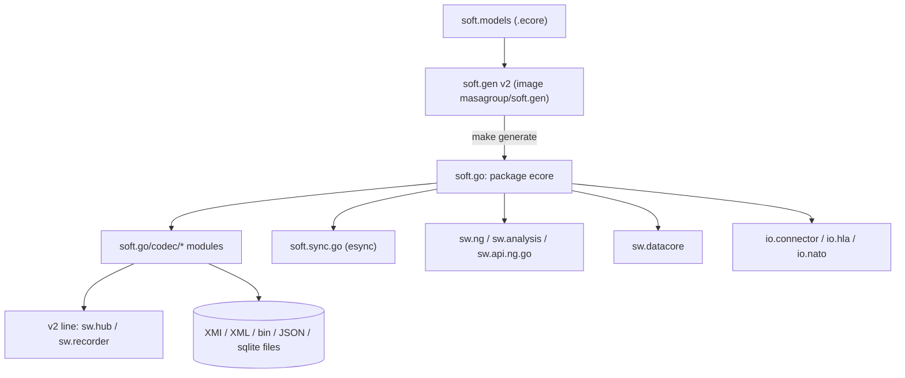
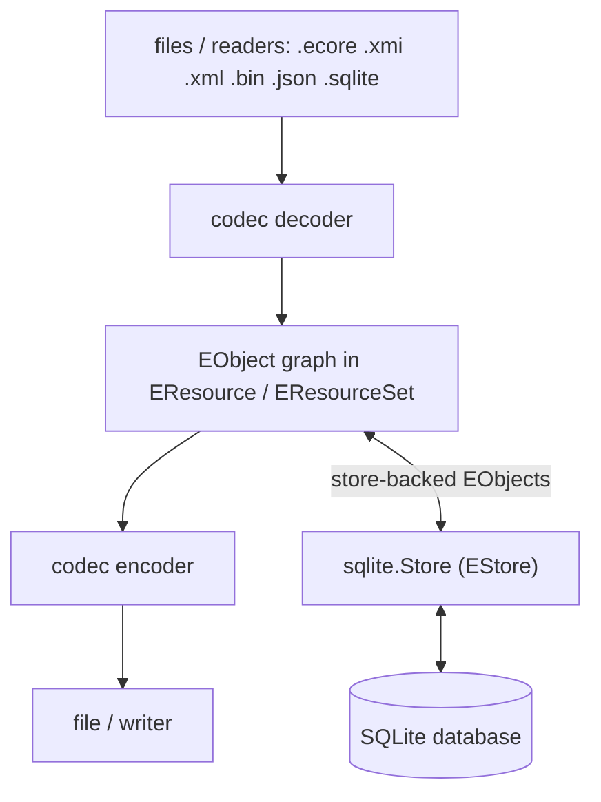
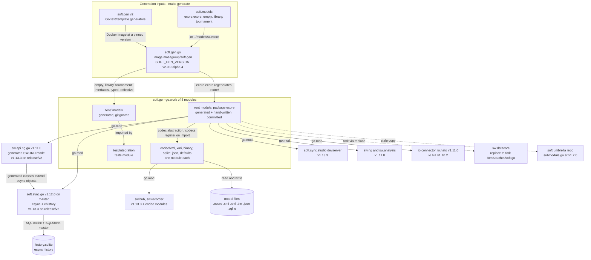
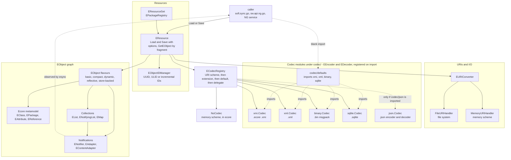
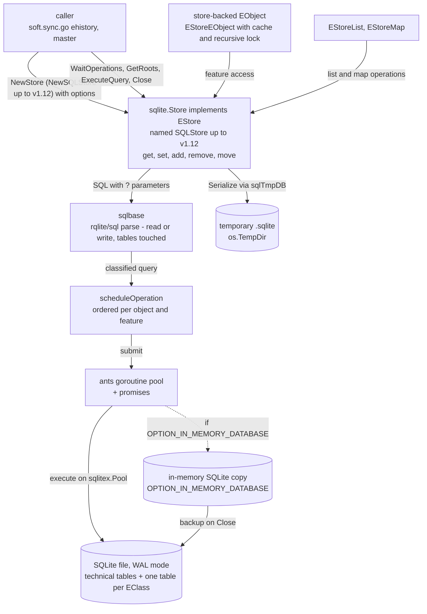
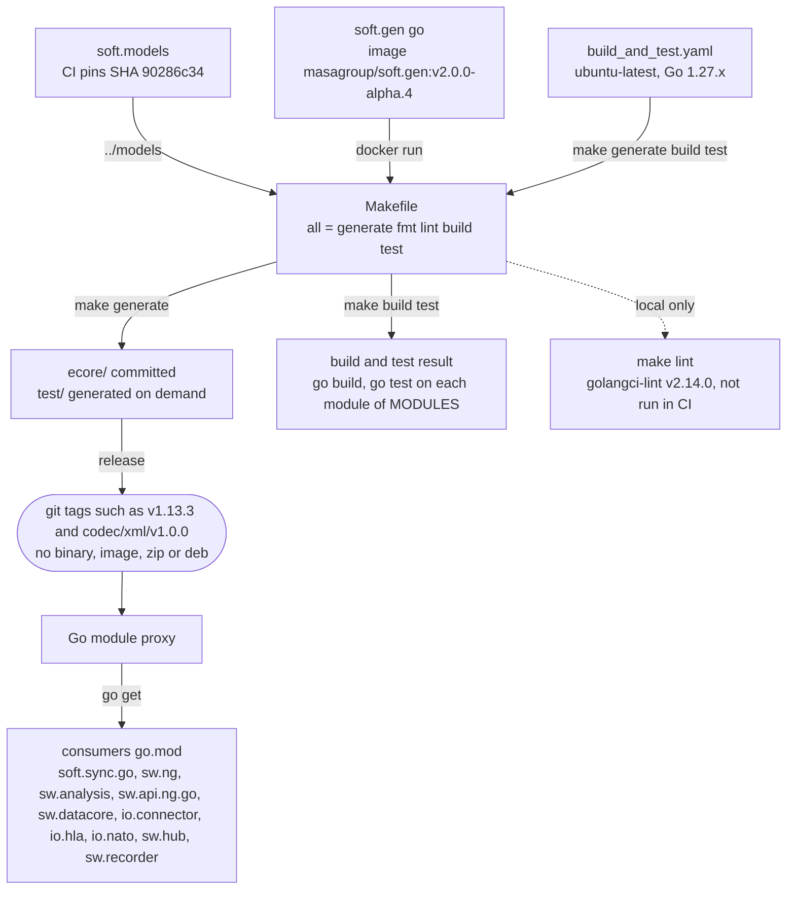

# soft.go: architecture

> Technical choices, diagrams and internal structure of `soft.go`. Back to the [README](README.md) · [Contributing](CONTRIBUTING.md) · [repository on GitHub](https://github.com/masagroup/soft.go)

| | |
|---|---|
| **Family** | Ecore / esync (the [Soft](https://github.com/masagroup/soft) family) |
| **Kind** | Go library (Go workspace of 8 modules: the core, 6 codec modules, the integration tests) |
| **Languages** | Go (100% of sources), Makefile, YAML |
| **Remote / branch** | github.com/masagroup/soft.go, default branch `master` |
| **Generation** | next gen (not shipped): consumed as Go modules by NG services, no binary or artifact of its own |
| **Build systems** | Go (`go.work`) · Makefile (generation with soft.gen v2, run from its Docker image `masagroup/soft.gen:v2.0.0-alpha.4`; `go` runs in a `golang` container when Go is missing). No Ant, no Dockerfile, no docker-compose, no CMake, no npm |

## Overview

The repository in its ecosystem (the text is in the [README](README.md#overview)):



## Position in the ecosystem

| Concept | Status |
|---|---|
| ecore model | Implements the Go Ecore runtime itself (`ecore/` package); see the ecosystem wiki page [esync and ecore](https://github.com/masagroup/wiki/wiki/esync-ecore) |
| esync | Used by esync: `soft.sync.go` requires soft.go v1.12.0 on `master` and v1.13.3 on `release/v2`. soft.go contains no esync code itself, only a test using an `esyncID` object-ID column |
| history | Indirect: the SQLite store (`SQLStore` up to v1.12, `sqlite.Store` of `codec/sqlite` now) is the persistence engine of esync's history database on the `master` of soft.sync.go (`soft.sync.go/internal/ehistory/history/*_database.go`) |
| hub, recorder | Used by the v2 line: [sw.recorder](https://github.com/masagroup/sw.recorder) requires soft.go v1.13.3 and `codec/xml`, [sw.hub](https://github.com/masagroup/sw.hub) requires it indirectly (both not shipped) |
| storage | Provides SQLite model persistence; `sw.storage` does not depend on soft.go |
| datacore | Used by [sw.datacore](https://github.com/masagroup/sw.datacore) through a fork `replace` to `BenSouchet/soft.go` |
| HLA | Not implemented here; [io.hla](https://github.com/masagroup/io.hla) depends on soft.go |
| gateway, dos, authentication, node, orchestrator, commander, timeline, mapserver, webclient, dispatcher | Unrelated (no code, config or reference in this repo). Of these, only [sw.ng](https://github.com/masagroup/sw.ng) depends on it (v1.11.0) |

See also the ecosystem wiki page [Next-gen ecosystem](https://github.com/masagroup/wiki/wiki/ecosystem-nextgen).

## Repository layout

```
soft.go/
  ecore/                    package `ecore` of the root module (~191 non-test .go files, ~150 *_test.go), generated + hand-written
    .soft.gen.yaml          marker written by soft.gen (generator, version, package; `.soft-gen.yaml` up to soft.gen v2.0.0-alpha.2)
  codec/                    one Go module per codec, each with its own go.mod and testdata/
    xml/                    XML codec, `xml.Processor`, extended metadata, XML namespaces
    xmi/                    XMI codec and processor (requires codec/xml)
    binary/                 msgpack binary codec
    sqlite/                 SQLite codec and `sqlite.Store` (EStore)
    json/                   JSON encoder and decoder (standard library only)
    defaults/               imports xmi, xml, binary and sqlite for their registration
  test/                     generated test models (root module) and integration tests
    library/                library model (generated, gitignored) + hand-written writer_ext.go
    tournament/             tournament model: shared package + interfaces + mocks (generated, gitignored except tournamentpackage_impl.go)
      typed/, reflective/   two implementations of the shared tournament package (generated, gitignored)
    empty/                  empty model (generated, gitignored)
    integration/            module `test/integration`: serialization, content-adapter, XML and coexistence tests on the generated models
  .github/workflows/        build_and_test.yaml (single workflow)
  Makefile                  generate / fmt / lint / build / test / coverage
  go.work, go.work.sum      workspace of the 8 modules
  .generator.yaml           generator properties: only fileNotes (MPL header injected by the generator); was generator.properties up to v1.13.1
  .golangci.yaml            golangci-lint v2 config (ignores SA1019 for staticcheck)
  .mockery.yaml             mockery config (inpackage, with-expecter)
  go.mod, go.sum, LICENSE (MPL 2.0), README.md
```

File-naming convention in `ecore/`: `<x>.go` = interface, `<x>_impl.go` = generated implementation, `<x>_ext.go` = hand-written extension, `<x>_mock.go` = mock (generated by soft.gen for the metamodel, by mockery for the hand-written interfaces). Generated files start with `// Code generated by soft.gen go. DO NOT EDIT.` (`soft-gen go` before v1.13.2).

## Architecture

The core lives in the package `ecore` (root module); each codec is a package of its own module under `codec/`.

1. **Ecore metamodel** (generated from `ecore.ecore`): `EModelElement`, `ENamedElement`, `EClassifier`, `EClass`, `EDataType`, `EEnum`, `EEnumLiteral`, `EStructuralFeature`, `EAttribute`, `EReference`, `EOperation`, `EParameter`, `EPackage`, `EFactory`, `EAnnotation`, `EGenericType`, `ETypeParameter`, `EStringToStringMapEntry`; `ecorepackage(_impl).go` (`NS_URI = "http://www.eclipse.org/emf/2002/Ecore"`), `ecorefactory(_impl).go`. The generator annotation source `http://net.masagroup/soft/2019/GenGo` is read in `edatatype_ext.go`.
2. **EObject flavours**: `abstracteobject.go`, `basiceobject_impl.go`, `compacteobject_impl.go` (bit-flag compact storage), `dynamiceobject_impl.go`, `reflectiveeobject_impl.go`, and store-backed variants `estoreeobject_impl.go`, `compactestoreeobject_impl.go`, `reflectiveestoreeobject_impl.go`. `EStoreEObject` = `EObject + EStoreProvider + ECacheProvider + ELockProvider`. The generator option `featureDelegation=Reflective` targets the reflective variants.
3. **Collections**: `EList`, `EObjectList`, `ENotifyingList`, `EMap`, basic / immutable / delegating / store-backed lists and maps (`basicelist.go`, `basicenotifyinglist.go`, `estorelist.go`, `estoremap.go`), iterators and `eallcontents.go`.
4. **Notifications and adapters**: `ENotifier`, `ENotification`, `ENotificationChain`, `EAdapter`, `EContentAdapter` (EMF observer pattern, the basis on which esync observes model changes).
5. **Resources**: `EResource` (Load/Save with options, `GetEObject(fragment)`, errors/warnings, `EObjectIDManager`), `EResourceSet`, `EPackageRegistry` (packages and, for shared packages, factories: `RegisterFactory`), `EURIConverter` + `EURIHandler` (file, memory), `URI` / `URIBuilder`.
6. **ID managers**: `EObjectIDManager`; generic `UniqueIDManager[ID]` with `UUIDManager`, `ULIDManager`, `IncrementalIDManager`.
7. **Codecs** (`ECodec` -> `EEncoder` / `EDecoder`), selected by `ECodecRegistry` by URI scheme, then extension, then `*` default, then delegate. `ecore` only maps the `memory:` scheme to `NoCodec`; the codec packages register their extensions when imported (see [Codecs](#codecs)). Options:

| Codec | Options |
|---|---|
| `xmi.Codec` | no option constant of its own; XMI processor built on `codec/xml` (`xml.ProcessorPackages`, `xml.ProcessorResourceSet`) |
| `xml.Codec` | `OPTION_EXTENDED_META_DATA`, `OPTION_SUPPRESS_DOCUMENT_ROOT`, `OPTION_DEFERRED_REFERENCE_RESOLUTION`, `OPTION_DEFERRED_ROOT_ATTACHMENT`, `OPTION_ID_ATTRIBUTE_NAME`, `OPTION_ROOT_OBJECTS` |
| `binary.Codec` | msgpack; `OPTION_ID_ATTRIBUTE`, `OPTION_NAMESPACE_ATTRIBUTE` (value `"NAMESPACE_ATTIBUTE"`, sic) |
| `sqlite.Codec` | options in `codec/sqlite/sqlcodec.go` (`OPTION_KEEP_DEFAULTS`, `OPTION_CODEC_VERSION`, `OPTION_OBJECT_ID`, `OPTION_CONTAINER_ID`, `OPTION_SQL_ID_MANAGER`, `OPTION_IN_MEMORY_DATABASE`, `OPTION_DECODER_WITH_FEATURES`, `OPTION_DECODER_WITH_OBJECTS`, `OPTION_DECODER_DB_PATH`, `OPTION_LOGGER`, `OPTION_OPERATION_TIMEOUT`, `OPTION_MAX_ALLOC_SIZE`, `OPTION_COMMIT_MAX_OPERATIONS`, `OPTION_COMMIT_MAX_DURATION`); codec version written to `PRAGMA user_version` |
| `json.Codec` | `OPTION_ID_ATTRIBUTE_NAME`; encoder and decoder |
| `ecore.NoCodec` | `memory:` scheme |

8. **SQLite persistence** (`codec/sqlite`):
   - Schema (`sqlschema.go`): technical tables `.properties`, `.packages`, `.classes`, `.objects` (optional `containerID` / `containerFeatureID` and an optional custom object-ID TEXT column, e.g. `esyncID` in `sqlencoder_test.go`), `.contents`, `.enums`, plus one table per EClass and per many-valued feature (qualified by the package, `package.class` / `package.class.feature`, in new databases; databases written before keep the unqualified names).
   - `Encoder` / `Decoder` (`NewWriterEncoder`, `NewDBEncoder`, `NewReaderDecoder`, `NewDBDecoder`): whole-resource save / load.
   - `Store` (`sqlstore.go`, ~2500 lines) implements `EStore`: every feature get/set/add/remove/move of a store-backed EObject becomes a SQL query on a WAL-mode SQLite pool, or on an in-memory copy backed up to the file on close (`OPTION_IN_MEMORY_DATABASE`). Operations are scheduled asynchronously (ants pool + promises) and ordered per object/feature. Public API includes `NewStore`, `WaitOperations`, `Flush`, `Err`, `GetRoots`, `UnRegister`, `Serialize`, `ExecuteQuery`, `Close`. `sqlbase.go` parses each query with `rqlite/sql` to classify read vs write and the tables touched, enabling concurrent reads.
   - `sqlequal.go`: compares two SQLite model databases (test helper with diff output).
9. **Utilities**: `ecoreutils.go`, `deepcopy.go`, `deepequal.go`, `ediagnostic*.go` in `ecore`; `extendedmetadata.go`, `xmlnamespaces.go` in `codec/xml`. The `ecore_check` build tag (`checks_enabled.go` / `checks_disabled.go`) turns on the programming-error checks (see [One shared package, several implementations](#one-shared-package-several-implementations)).



Data flow: in, files or readers go through a codec decoder into an EObject graph held by an `EResource` / `EResourceSet`; out, the graph goes through an encoder to a file or writer. With `sqlite.Store`, EObjects are thin proxies and the SQLite database is the source of truth (live persistence, used by the esync history in `soft.sync.go`).

Notable patterns: model-driven code generation (soft.gen + soft.models), EMF adapter/notification observer, pluggable codec registry with codecs as opt-in modules, pluggable `EStore`, one shared package with several implementations, mockery in-package mocks, Go iterators (`iter.Seq` in `estore.go`), generics.

## How it works

soft.go is a Go workspace (`go.work`) of eight Go modules, all `go 1.27.0`: the root module `github.com/masagroup/soft.go` (package `ecore`), six codec modules under `codec/` (`xml`, `xmi`, `binary`, `sqlite`, `json`, `defaults`) and the tests-only module `test/integration`. Together they are MASA's Go implementation of the Eclipse EMF Ecore runtime, with the generated Ecore metamodel, several `EObject` flavours, notifying collections and adapters, resources and URI handlers, and the codec abstraction; since v1.13.0 the model codecs (XMI, XML, msgpack binary, JSON, SQLite) and `sqlite.Store` (named `SQLStore` up to v1.12), an `EStore` backed by SQLite, are separate modules. Nothing runs on its own: there is no `package main`, no port, no flag and no environment variable; a caller loads `.ecore` / `.xmi` / `.xml` / `.bin` / `.json` / `.sqlite` files or readers into an `EObject` graph and saves it back, or binds store-backed objects live to a SQLite database. Part of the root module is generated from [soft.models](https://github.com/masagroup/soft.models) by `soft.gen go` of soft.gen v2 (Go `text/template` generators, run from the Docker image `masagroup/soft.gen`), and releases are plain git tags (HEAD = `v1.13.3`, 2026-10-23; `codec/<name>/vX.Y.Z` for the codec modules) pulled through the Go module proxy. It is a next gen brick with no artifact of its own: it is the model foundation of the esync library [soft.sync.go](https://github.com/masagroup/soft.sync.go) and is compiled into the next gen Go repositories that require it (sw.ng, sw.analysis, sw.api.ng.go, sw.datacore, io.connector, io.hla, io.nato on versions where the codecs were in `ecore`; sw.hub, sw.recorder and the `release/v2` branches of soft.sync.go and sw.api.ng.go on v1.13.3 with the codec modules).

### Components and data flow



- `make generate` runs `soft.gen go` six times on the metamodels of [soft.models](https://github.com/masagroup/soft.models) (read from `../models`, with `-P .generator.yaml`, which only injects the MPL header): `ecore.ecore` regenerates the committed `ecore/` package; `empty.ecore` and `library.ecore` produce the gitignored models under `test/`; `tournament.ecore` is generated three times with `-p packageInstance=interfaces`: interfaces and mocks into `test/tournament`, a typed implementation into `test/tournament/typed` and a reflective implementation (`featureDelegation=Reflective`) into `test/tournament/reflective`. soft.gen is not a `go.mod` require: the Makefile runs the image `masagroup/soft.gen:v2.0.0-alpha.4` (`SOFT_GEN_VERSION`, `SOFT_GEN_IMAGE`) with the repository mounted on `/soft/go` and `../models` on `/soft/models`; the generator properties are in `.generator.yaml` (`generator.properties` up to v1.13.1). Up to v1.13.1 the Makefile ran `go run github.com/masagroup/soft.gen/v2/cmd/soft-gen@v2.0.0-alpha.2`; the command is `cmd/soft.gen` from soft.gen v2.0.0-alpha.3 (see [soft.gen](https://github.com/masagroup/soft.gen)). When Go is not installed, the other targets run `go` in a `golang:1.27.3-alpine` container.
- The core is the package `ecore` of the root module (~191 non-test files, ~150 test files). Naming convention: `<x>.go` = interface, `<x>_impl.go` = generated implementation, `<x>_ext.go` = hand-written extension, `<x>_mock.go` = mock (generated by soft.gen for the metamodel, by mockery for the hand-written interfaces). Generated files start with `// Code generated by soft.gen go. DO NOT EDIT.` (`soft-gen go` before v1.13.2) and keep `// Start of user code` / `// End of user code` regions.
- The codecs are separate packages and modules, so a program only depends on the libraries of the codecs it uses: `ecore` only holds the codec abstraction (`ECodec`, `ECodecRegistry`) and maps `memory:` to `NoCodec`; each codec package registers its extensions in the default registry when it is imported, and `codec/defaults` imports xmi, xml, binary and sqlite for that purpose. Without a codec for the extension of a resource, `Load` and `Save` fail with an error naming the package to import. Consumers still on v1.10 / v1.11 / v1.12 must require the codec modules and rename the symbols when they upgrade (`XMICodec` -> `xmi.Codec`, `SQLStore` -> `sqlite.Store`, ...); only the v2 line (sw.recorder, sw.hub, the `release/v2` branches of soft.sync.go and sw.api.ng.go, the soft.sync.studio devserver) and soft.gen require `codec/*` modules.
- Consumers pull it only through `go.mod` (no Ant `<update>`, no Docker-as-artifact image). soft.sync.go (v1.12.0 on `master`) builds esync and ehistory on it: esync ships resource contents in the soft.go binary codec (with the ID attribute) over WebSocket `/sync`, and ehistory persists its history database through the SQL codec and `ecore.NewSQLStore` (now `sqlite.NewStore` of `codec/sqlite`). The other next gen repositories of the v1 line are on v1.11.0 (io.hla on v1.10.2), the v2 line on v1.13.3; sw.datacore replaces soft.go with the fork `github.com/BenSouchet/soft.go` (reason UNVERIFIED), and the `soft` umbrella repo keeps a stale v1.7.0 copy as submodule `go`.
- sw.api.ng.go ties every generated SWORD class to esync: its generator maps the Ecore package to `soft.go/ecore#soft.sync.go/esync#soft.go/ecore` and sets `rootExtendsClass` to esync's `CompactEObjectContainer`, so each class is a sync-aware soft.go `EObject` consumed by sw.ng (swgateway, swhistory), sw.analysis and io.*. Switching the sync library means regenerating every consumer of sw.api.ng.*.
- I/O is limited to the file system (`FileURIHandler`), the in-memory `memory:` scheme (`MemoryURIHandler`) and SQLite files through the pure-Go driver `zombiezen.com/go/sqlite` (modernc, no CGO) in `codec/sqlite`, plus temporary `.sqlite` files in `os.TempDir()` when the SQLite codec works on an `io.Reader` / `io.Writer` or when `sqlite.Store.Serialize` runs. Because the `*_mock.go` files of `ecore` are compiled into the package, testify is linked into every consumer; likewise `codec/sqlite` compiles `sqlobject_mock.go` and `sqlequal.go`, so its consumers also link go-spew and go-difflib.

### Inside the ecore package and the codecs



- The Ecore metamodel (`EModelElement` ... `EStringToStringMapEntry`, `ecorepackage` with `NS_URI = "http://www.eclipse.org/emf/2002/Ecore"`, `ecorefactory`) is generated from `ecore.ecore`; the generator annotation source `http://net.masagroup/soft/2019/GenGo` is read by `edatatype_ext.go`.
- `EObject` flavours: basic, compact (bit-flag storage), dynamic, reflective, and the store-backed variants (`EStoreEObject` = `EObject + EStoreProvider + ECacheProvider + ELockProvider`, compact variant with a feature-value cache bitmask for feature IDs 0..63). The generator option `featureDelegation=Reflective` targets the reflective variants; esync v2 requires it, which routes every get/set through a store and changes the cost of hot paths (transverse analysis).
- `ECodecRegistry` picks a codec by URI scheme, then extension, then the `*` default, then a delegate registry. `ecore` only maps `memory:` to `NoCodec`; the codec packages register their extensions on import: XMI for `.ecore` / `.xmi`; XML for `.xml` (options `OPTION_EXTENDED_META_DATA`, `OPTION_SUPPRESS_DOCUMENT_ROOT`, `OPTION_DEFERRED_REFERENCE_RESOLUTION`, `OPTION_DEFERRED_ROOT_ATTACHMENT`, `OPTION_ID_ATTRIBUTE_NAME`, `OPTION_ROOT_OBJECTS`); msgpack binary for `.bin` (options `OPTION_ID_ATTRIBUTE`, `OPTION_NAMESPACE_ATTRIBUTE`, whose value is spelled `NAMESPACE_ATTIBUTE`, sic); SQLite for `.sqlite`; JSON for `.json` (encoder and decoder, standard library only, not part of `codec/defaults`). The XMI codec is built on `codec/xml` (`xml.ProcessorPackages`, `xml.ProcessorResourceSet`).
- `EResource` offers Load / Save with options and reader / writer variants, `GetEObject(fragment)`, errors and warnings, and an `EObjectIDManager`; IDs come from the generic `UniqueIDManager[ID]` (`UUIDManager`, `ULIDManager`, `IncrementalIDManager`). `EResourceSet`, `EPackageRegistry` (packages and, for shared packages, factories: `RegisterFactory`) and `EURIConverter` + `EURIHandler` (file, memory) complete the resource layer.
- `ENotifier`, `ENotification`, `ENotificationChain`, `EAdapter` and `EContentAdapter` implement the EMF observer pattern on which esync observes model changes; notifications are per feature, so one SWORD message produces many notifications that an esync commit groups. Helpers: `ecoreutils.go`, `deepcopy.go`, `deepequal.go`, `ediagnostic*.go` in `ecore`; `extendedmetadata.go` and `xmlnamespaces.go` in `codec/xml`. The `ecore_check` build tag turns on the programming-error checks.
- A metamodel can be generated as one shared package (generator property `packageInstance=interfaces`) with several implementations (typed, reflective; the tournament test model is built this way): each implementation has its own factory, and each resource set chooses its implementation by registering the factory in its package registry (`RegisterFactory`); there is no global default implementation, and objects of different implementations do not mix (checked with the `ecore_check` tag).

### Inside sqlite.Store



- Database layout (`sqlschema.go` in `codec/sqlite`): technical tables `.properties`, `.packages`, `.classes`, `.objects` (optional `containerID` / `containerFeatureID` and an optional custom object-ID TEXT column, such as `esyncID` in a test), `.contents`, `.enums`, plus one table per EClass and per many-valued feature; the codec version is written to `PRAGMA user_version` (1 in the v1.11.1 scan). `Encoder` / `Decoder` save and load a whole resource with this layout; `Store` (~2500 lines) works on it live.
- With `sqlite.Store`, store-backed `EObject`s are thin proxies and the database is the source of truth: each feature get / set / add / remove / move becomes a SQL query. Values are bound as `?` parameters; table and column names come from the metamodel and go through `sqlEscapeIdentifier`, which only wraps a name in double quotes when it contains `.` or equals an SQLite keyword and does not escape embedded quotes.
- Concurrency: `sqlbase.go` parses each query with `rqlite/sql` to classify it read or write and list the tables it touches, enabling concurrent reads; operations are scheduled asynchronously (ants pool + promises, `scheduleOperation`) and ordered per object and feature; `goid` tracks goroutine IDs for re-entrant operations, store-backed objects lock through `ELockProvider` (recursive mutex `SokaDance/rmx` in the v1.11.1 scan; the current dependency table of the page no longer lists it, UNVERIFIED), and logging goes to zap (`OPTION_LOGGER`, no-op by default).
- Two storage modes: a WAL-mode `sqlitex.Pool` on the file, or an in-memory copy backed up to the file on `Close` (`OPTION_IN_MEMORY_DATABASE`). `Serialize` goes through a temporary database in `os.TempDir()`. `ExecuteQuery` takes raw SQL and treats only an exact upper-case `SELECT` first token as a read; everything else is scheduled as a write.
- Only the `master` of soft.sync.go (`internal/ehistory/history/history_builder_database.go`, `history_database_reader_database.go`, `history_sync_reader_database.go`) calls `NewSQLStore` (the soft.sync.studio devserver, now on soft.sync.go v2, no longer does); no sw.* or io.* consumer uses it directly, and whether next gen services will is UNVERIFIED.

### From sources to artifacts



- The only build system is the root `Makefile` plus the Go toolchain (GNU make; it detects `go` / `go.exe` and Windows vs POSIX `mkdir`) and `go.work`: no `build.xml`, `Dockerfile`, `docker-compose.yaml`, CMake or npm. `go build ./ecore/...` and `go test -covermode=atomic ./ecore/...` work on a fresh clone, and so does `go -C codec/<name> test ./...` for the codec modules; `make build` and `make test` loop over the eight `MODULES` with `go -C <module>` and need `make generate` first on a fresh clone, because the generated `test/` models are gitignored and the integration tests import them. Docker runs the generator (`make generate`), `make lint`, and `go` when Go is not installed.
- `make generate` reads the models from `../models`: CI checks soft.models out as `models/` at the pinned SHA `90286c344159492747920472760ac3904b19e784`, while the workspace clone is `..\soft.models` (HEAD `f0dd72e4...`); how developers run it locally, and the impact of that pin, are UNVERIFIED.
- CI is one self-contained workflow, `.github/workflows/build_and_test.yaml` (pull request to `master`, push to `master`, `workflow_dispatch`), outside the `masagroup/cicd` shared workflows; it runs `make generate build test`, has no lint step, no coverage upload and publishes nothing.
- Releases are git tags consumed through the Go module proxy: `v1.13.3`, `v1.13.2`, `v1.13.1`, `v1.13.0`, `v1.12.0`, ... for the root module and `codec/<name>/vX.Y.Z` for the codec modules. The consumers of the v1 line are on v1.11.0 (io.hla on v1.10.2, the `master` of soft.sync.go on v1.12.0) while HEAD is v1.13.3 (2026-10-23); the v2 line (sw.hub, sw.recorder, the `release/v2` branches, the soft.sync.studio devserver) requires v1.13.3. Since v1.13.0 the codecs and the SQLite store are separate modules with renamed symbols, so an upgrade needs code changes; other breaking changes between v1.10.2 and v1.11.x are UNVERIFIED. A generator template change ripples soft.gen -> runtimes -> sw.api.ng.* -> consumers.

## Dependencies

### Internal

Upstream (what soft.go depends on):

| Repository | How it is pulled | What for |
|---|---|---|
| [soft.gen](https://github.com/masagroup/soft.gen) v2 | Docker image `masagroup/soft.gen:v2.0.0-alpha.4` run by the `Makefile` (`SOFT_GEN_VERSION`, `SOFT_GEN` / `GENERATE` macros, properties in `.generator.yaml`), not a `go.mod` require; `go run github.com/masagroup/soft.gen/v2/cmd/soft-gen@v2.0.0-alpha.2` up to v1.13.1 | Generates `ecore/*.go` and the `test/` models |
| [soft.models](https://github.com/masagroup/soft.models) | CI checkout of `masagroup/soft.models` pinned at `90286c344159492747920472760ac3904b19e784`; Makefile expects `../models` | Source `.ecore` metamodels: `ecore.ecore`, `empty.ecore`, `library.ecore`, `tournament.ecore` |

The only `github.com/masagroup/*` requires are between the modules of this repository: the codec modules require `github.com/masagroup/soft.go v1.13.0` and the codec modules they build on (`codec/xml v1.0.0`, `codec/xmi v1.0.0`, ...), resolved locally by `go.work`. No `.gitmodules`, no Ant `<update>`.

Downstream (who requires soft.go):

| Repository | How it is pulled | What for |
|---|---|---|
| [soft.sync.go](https://github.com/masagroup/soft.sync.go) | go.mod (v1.12.0 on `master`; v1.13.3 and the codec modules `binary`, `xmi`, `xml` on `release/v2`) | esync; on `master` uses `ecore.NewSQLStore` in `internal/ehistory/history/history_builder_database.go`, `history_database_reader_database.go`, `history_sync_reader_database.go` (`sqlite.NewStore` of `codec/sqlite` since v1.13.0); `release/v2` does not require `codec/sqlite` |
| [soft.sync.studio](https://github.com/masagroup/soft.sync.studio) (devserver) | go.mod (v1.13.3) | Dev server of the v2 web UI |
| [soft.gen](https://github.com/masagroup/soft.gen) | go.mod (v1.13.3-0.20261022175029-abd1d4df298b, `codec/xmi` and `codec/xml` pseudo-versions) | Loads the `.ecore` models it generates from |
| [sw.ng](https://github.com/masagroup/sw.ng) | go.mod (v1.11.0) | Ecore model runtime |
| [sw.datacore](https://github.com/masagroup/sw.datacore) | go.mod (v1.11.0) + `replace` to fork `github.com/BenSouchet/soft.go` | Ecore model runtime (fork reason UNVERIFIED) |
| [sw.analysis](https://github.com/masagroup/sw.analysis), [sw.api.ng.go](https://github.com/masagroup/sw.api.ng.go) | go.mod (v1.11.0; v1.13.3 and `codec/xml` on the `release/v2` branch of sw.api.ng.go) | Ecore model runtime |
| [sw.recorder](https://github.com/masagroup/sw.recorder) | go.mod (v1.13.3 and `codec/xml` v1.0.0) | Ecore model runtime and XML codec |
| [sw.hub](https://github.com/masagroup/sw.hub) | go.mod (v1.13.3, indirect) | Through `soft.sync.go/v2` and `sw.api.ng.go/v2` |
| [io.connector](https://github.com/masagroup/io.connector), [io.nato](https://github.com/masagroup/io.nato) | go.mod (v1.11.0) | Ecore model runtime |
| [io.hla](https://github.com/masagroup/io.hla) | go.mod (v1.10.2) | Ecore model runtime |
| [soft](https://github.com/masagroup/soft) (umbrella repo) | git submodule `go`, pinned at v1.7.0 (`go 1.20`, commit c80fbf86) | Stale second copy of the module on disk (`soft\soft\go`) |

The codec modules are required by the v2 line only: `soft.sync.go/v2`, `sw.api.ng.go/v2`, sw.recorder (direct), sw.hub and the soft.sync.studio devserver (indirect), plus soft.gen. The other consumers are on versions where the codecs were in `ecore`.

Indirect esync path: `sw.ng/src`, `sw.analysis/src`, `sw.api.ng.go` and `io.connector` require `soft.sync.go` v1.6.2 and `sw.datacore` v1.6.1 (`io.nato` v1.6.2 and `io.hla` v1.6.1: indirect); `sw.datacore` also replaces `soft.sync.go` with the fork `github.com/BenSouchet/soft.sync.go v1.6.2-0.20261017105210-534e68b53610`. sw.hub, sw.recorder and the soft.sync.studio devserver require `soft.sync.go/v2`. Only the `master` of `soft.sync.go` calls `ecore.NewSQLStore` / `SQL_OPTION_*`; no direct SQLStore usage was found in the sw.* / io.* consumers. No `go.mod` under `sw.storage`, `sw.golibs`, `sw.node`, `sw.dos`, `sw.commander`, `sw.mapserver`, `sw.authentication` requires soft.go.

### External

Direct requires, per module:

| Module | Requires | Purpose |
|---|---|---|
| root (`ecore`) | `github.com/google/uuid` v1.6.0, `github.com/oklog/ulid/v2` v2.1.2 | UUID / ULID object IDs |
| root (`ecore`) | `github.com/ugurcsen/gods-generic` v0.10.4 | Generic collections |
| root (`ecore`) | `github.com/stretchr/testify` v1.12.1 | Tests and the in-package mocks |
| `codec/xml` | `golang.org/x/net` v0.61.0 | XML charset handling / escaping |
| `codec/binary` | `github.com/vmihailenco/msgpack/v5` v5.4.1 (+ uuid, ulid) | Binary (`.bin`) codec |
| `codec/sqlite` | `zombiezen.com/go/sqlite` v1.4.2 (indirect `modernc.org/sqlite v1.60.1`) | Pure-Go SQLite driver, connection pools (`sqlitex.Pool`), backup API |
| `codec/sqlite` | `github.com/rqlite/sql` v0.0.0-20261016220845-5c0832fea6e1 | SQL parser: classifies queries read/write and extracts table names (`sqlbase.go`) |
| `codec/sqlite` | `github.com/chebyrash/promise` v0.0.0-20260915144232-ce593674804a | Promise-based async SQL operations |
| `codec/sqlite` | `github.com/panjf2000/ants/v2` v2.12.1 | Goroutine pools (`sqlstore.go`) |
| `codec/sqlite` | `github.com/petermattis/goid` v0.0.0-20260918085751-abfca077860b | Goroutine ID tracking for re-entrant SQL operations |
| `codec/sqlite` | `go.uber.org/zap` v1.28.0 | Logging (`OPTION_LOGGER`), default `zap.NewNop()` |
| `codec/sqlite` | `github.com/davecgh/go-spew` v1.1.1, `github.com/pmezard/go-difflib` v1.0.0 | Diff output when comparing SQLite databases (`sqlequal.go`) |
| `codec/json` | none outside the repository (standard library; testify for tests) | JSON encoder and decoder |

The `*_mock.go` files of `ecore` are compiled into the library package, so testify is linked into every consumer, not only tests; likewise `codec/sqlite` compiles `sqlobject_mock.go` and `sqlequal.go` (exported `RequireEqualDB`), so its consumers also link go-spew and go-difflib.

Tooling: Go 1.27.x (`go.mod`, CI matrix), `masagroup/soft.gen:v2.0.0-alpha.4` (generation), `golang:1.27.3-alpine` (`go` without Go installed), `golangci/golangci-lint:v2.14.0-alpine`, mockery, `actions/setup-go@v5`, `actions/checkout@v4`.

## Codecs

The `ecore` module only holds the codec abstraction (`ECodec`, `ECodecRegistry`) and maps the `memory` protocol to `NoCodec`. The codecs are separate packages and modules, so a program only depends on the libraries of the codecs it uses:

| Package | Module | Codec | Extensions registered on import |
|---|---|---|---|
| `github.com/masagroup/soft.go/codec/xmi` | same as the package (requires `codec/xml`) | XMI | `ecore`, `xmi` |
| `github.com/masagroup/soft.go/codec/xml` | same as the package | XML | `xml` |
| `github.com/masagroup/soft.go/codec/binary` | same as the package | binary (msgpack) | `bin` |
| `github.com/masagroup/soft.go/codec/sqlite` | same as the package | SQLite codec and `Store` | `sqlite` |
| `github.com/masagroup/soft.go/codec/json` | same as the package | JSON (encoder and decoder, standard library only) | `json` |
| `github.com/masagroup/soft.go/codec/defaults` | same as the package | XMI, XML, binary and SQLite | `ecore`, `xmi`, `xml`, `bin`, `sqlite` |

A codec package registers its codecs in the default codec registry when it is imported. To load and save resources by extension as before, import the defaults for their side effects:

```go
import (
  _ "github.com/masagroup/soft.go/codec/defaults"
)
```

Without a codec for the extension of a resource, `Load` and `Save` fail with an error naming the package to import. Codecs can also be registered with `ecore.RegisterCodec(extension, codec)`, or per resource set in `resourceSet.GetCodecRegistry()`.

The packages are named like `encoding/xml`, `encoding/binary`, `zombiezen.com/go/sqlite` and `encoding/json`: a file importing both names one of them, for instance `xmlcodec "github.com/masagroup/soft.go/codec/xml"`.

### Migration from v1.12

The package name replaces the prefix of the names:

| v1.12 (`ecore`) | now |
|---|---|
| `XMICodec`, `NewXMIProcessor`, `NewXMIEncoder`, `NewXMIDecoder` | `xmi.Codec`, `xmi.NewProcessor`, `xmi.NewEncoder`, `xmi.NewDecoder` |
| `XMLCodec`, `NewXMLProcessor`, `XMLProcessorPackages`, `XMLProcessorResourceSet`, `XML_OPTION_*` | `xml.Codec`, `xml.NewProcessor`, `xml.ProcessorPackages`, `xml.ProcessorResourceSet`, `xml.OPTION_*` |
| `XMIProcessorPackages`, `XMIProcessorResourceSet` | `xml.ProcessorPackages`, `xml.ProcessorResourceSet` |
| `BinaryCodec`, `NewBinaryEncoder`, `NewBinaryDecoder`, `BINARY_OPTION_*` | `binary.Codec`, `binary.NewEncoder`, `binary.NewDecoder`, `binary.OPTION_*` |
| `SQLCodec`, `SQLStore`, `NewSQLStore`, `SQLObject`, `SQL_OPTION_*`, `ErrSQLStoreFailed` | `sqlite.Codec`, `sqlite.Store`, `sqlite.NewStore`, `sqlite.Object`, `sqlite.OPTION_*`, `sqlite.ErrStoreFailed` |
| `JSONCodec`, `NewJSONEncoder`, `JSON_OPTION_ID_ATTRIBUTE_NAME` | `json.Codec`, `json.NewEncoder`, `json.OPTION_ID_ATTRIBUTE_NAME` |

## Several implementations of a metamodel

A program may link several complete generated implementations of the same metamodel (for instance one with typed fields and one with reflective delegation). They share the nsURI and the classifier and feature IDs, but each has its own `EPackage` instance and its own `EFactory`.

A package registry holds one package per nsURI, so the implementation is chosen per resource set: register the package of the implementation a resource set uses in that resource set's registry, with `ecore.CreateEResourceSet(packages)`, `xml.ProcessorPackages(packages)` or `resourceSet.GetPackageRegistry().RegisterPackage(pack)`. The global registry (`ecore.GetPackageRegistry()`) holds `ecore` only and stays neutral: generated packages never register themselves in it.

```go
fieldsSet := ecore.CreateEResourceSet([]ecore.EPackage{fields.GetPackage()})
storeSet := ecore.CreateEResourceSet([]ecore.EPackage{store.GetPackage()})
```

What works within one implementation and across two implementations of the same metamodel:

| Operation | Same implementation | Across (same nsURI, same IDs) |
| --- | --- | --- |
| generated factory `Create` / `CreateFromString` / `ConvertToString` | works | works, by classifier ID; the result belongs to the factory's package |
| dynamic `EFactoryExt` | works | panics (package mismatch), unchanged |
| `EGetFromID` / `ESetFromID`, `GetEStructuralFeature(id)`, `...FromName` | works | works |
| `EGet` / `ESet` / `EIsSet` / `EUnset(feature)` | works | panics "not a valid feature": look the feature up by ID or name on `obj.EClass()` first |
| load into a resource set with one implementation registered | works | works; the whole resource is that implementation |
| save a resource mixing implementations | n/a | unsupported |
| `Copy` | works, same implementation | not a cross copy |
| `Equals`, `IsSuperTypeOf`, `IsInstance`, proxies across resource sets | works | false / unsupported |

### One shared package, several implementations

Generated with the property `packageInstance=interfaces` of soft.gen go (soft.gen v2), the package of a metamodel (`GetPackage`) is generated once, with its interfaces, and shared by its implementations: each implementation (`generateImplementations`, one run each) holds its classes and a factory of its own (`GetFactory`), whose package is the shared one. The objects of all implementations have the same `EClass`. The factory instance of the shared package only converts data types: its `Create` panics. The tournament test model (`test/tournament`, `typed/`, `reflective/`) is generated this way.

The implementation a resource set creates its objects with (load, XML, binary and SQL) is the factory registered for the nsURI in its package registry:

```go
typedSet := ecore.CreateEResourceSet([]ecore.EPackage{model.GetPackage()})
typedSet.GetPackageRegistry().RegisterFactory(typed.GetFactory())
reflectiveSet := ecore.CreateEResourceSet([]ecore.EPackage{model.GetPackage()})
reflectiveSet.GetPackageRegistry().RegisterFactory(reflective.GetFactory())
```

There is no global default implementation: each resource set chooses its implementation in its registry. The generated `Install(registry)` of an implementation registers the shared package and the factory of the implementation (`typed.Install(resourceSet.GetPackageRegistry())`).

`ecore.GetObjectFactory(obj)` returns the factory of the implementation of an object: `Copy` and the entries of maps are of the implementation of the object they come from. The objects of different implementations of a shared package do not mix: containing, referencing (lists, single references, `ESet`) or adding as a root of the same resource an object of another implementation panics (`ecore.CheckSameImplementation`) when the program is built with the tag `ecore_check` (`ecore.Checks`). Without it, the checks are compiled out and cost nothing. The same tag enables the other checks of programming errors, such as setting an element of a unique list to an element it holds at another index. The property `checkImplementation=false` of soft.gen go (soft.gen v2) also leaves them out of the generated setters. Within one implementation, everything works as with a complete package, including `EGet` / `ESet` with the features of `GetPackage()`, `Equals` and `IsSuperTypeOf`.
