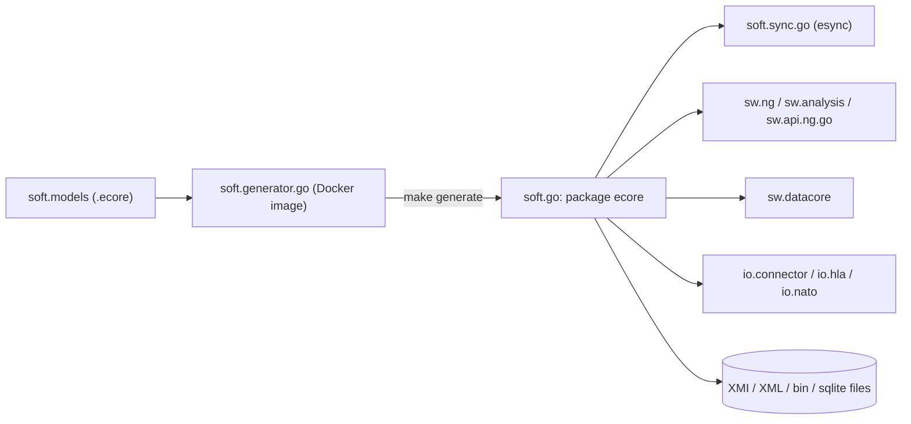
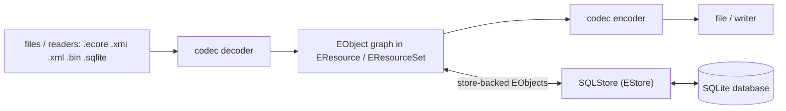

---
sword:
  schema: 1
  name: soft.go
  family: ecore-esync
  kind: go-lib
  generation: next-gen
  shipped: false
  languages: [Go, Makefile, YAML]
  build: [go, make]
  ng: [history, datacore, esync, ecore-model, hla]
  apps: []
---

# soft.go

[](https://github.com/masagroup/soft.go/blob/master/LICENSE)

[](https://github.com/masagroup/soft.go)


> Go implementation of the Eclipse EMF Ecore metamodel runtime (EObject, EClass, EResource, notifications) with model codecs (XMI, XML, binary, JSON write-only, SQLite) and a SQLite-backed `EStore`; it is the model foundation library of the Next-Gen Go services and of the esync library `soft.sync.go`.

| | |
|---|---|
| **Family** | Ecore / esync (the "Soft" family) |
| **Kind** | Go library |
| **Languages** | Go (100% of sources), Makefile, YAML |
| **Remote / branch** | github.com/masagroup/soft.go, default branch `master` |
| **Generation** | next gen (not shipped): consumed as a Go module by NG services, no binary or artifact of its own |
| **Build systems** | Go · Makefile (generation via Docker image `masagroup/soft.generator.go`). No Ant, no Dockerfile, no docker-compose, no CMake, no npm |

## Overview

soft.go provides the Go runtime of the Ecore metamodel: the generated metamodel classes (`EClass`, `EPackage`, `EAttribute`, ...), several `EObject` flavours (basic, compact, dynamic, reflective, store-backed), collections, EMF-style notifications and adapters, resources and resource sets, URI handlers, ID managers, and a set of codecs that read and write model resources. It also ships `SQLStore`, an `EStore` implementation where every feature access of a store-backed `EObject` becomes a SQL query on a SQLite database.

The repository is a pure library: no `package main`, no network listener, no `flag` / `os.Getenv` usage in non-test code. It is consumed with `go get github.com/masagroup/soft.go` (Go module proxy / GitHub tags). Module path: `github.com/masagroup/soft.go`, `go 1.27.0`.

Who uses it (from their `go.mod`):

| Consumer | Version required |
|---|---|
| `soft/soft.sync.go` (esync) | v1.11.0 |
| `soft/soft.sync.studio/devserver` | v1.11.1 |
| `sw/sw.ng/src` | v1.10.2 |
| `sw/sw.datacore` | v1.10.2, replaced by fork `github.com/BenSouchet/soft.go v1.10.3-0.20261005102653-6e14d517bed8` |
| `sw/sw.analysis/src`, `sw/sw.api.ng.go` | v1.10.2 |
| `io/io.connector`, `io/io.hla`, `io/io.nato` | v1.10.2 |
| `soft/soft` (umbrella repo, submodule `go`) | v1.7.0 (stale) |

Most sw.* / io.* consumers are on v1.10.2 (tagged 2025-10-29) while HEAD is v1.11.1 (2026-10-14).



## Repository layout

```
soft.go/
  ecore/                    single library package `ecore` (~213 non-test .go files, ~157 *_test.go), generated + hand-written
    testdata/               codec fixtures: .ecore .xml .xmi .bin .json .sqlite (library, emap, alltypes, shop, orders, tree...)
  test/                     integration tests on generated models
    library/                hand-written writer_ext.go and serialization / content-adapter tests
    tournament/             tournament model (generated, gitignored)
    tournament-reflective/  same model generated with featureDelegation=Reflective
    empty/                  empty model
  .github/workflows/        build_and_test.yaml (single workflow)
  Makefile                  generate / fmt / lint / build / test / coverage
  generator.properties      only defines fileNotes (MPL header injected by the generator)
  .golangci.yaml            golangci-lint v2 config (ignores SA1019 for staticcheck)
  .mockery.yaml             mockery config (inpackage, with-expecter)
  go.mod, go.sum, LICENSE (MPL 2.0), Readme.md
```

File-naming convention in `ecore/`: `<x>.go` = interface, `<x>_impl.go` = generated implementation, `<x>_ext.go` = hand-written extension, `<x>_mock.go` = mockery mock. Generated files start with `// Code generated by soft.generator.go. DO NOT EDIT.` and keep `// Start of user code` / `// End of user code` regions.

## Build

The only build system is the root `Makefile` plus the standard Go toolchain (GNU make required; the Makefile detects `go` / `go.exe` and Windows vs POSIX `mkdir`, so it runs on both Windows and Linux).

### Windows (Ant)

Not applicable: no `build.xml`.

### Linux (Docker)

Not applicable: no `Dockerfile` or `docker-compose.yaml`. Docker is only used by `make generate` (image `masagroup/soft.generator.go`) and `make lint` (image `golangci/golangci-lint:v2.14.0-alpine`).

### Other

#### Go and Makefile

Run from the repository root:

```powershell
# library only (ecore/ is committed, no generation needed)
go build ./ecore/...
go test -covermode=atomic ./ecore/...

# full pipeline as in CI (needs Docker + the soft.models repo checked out as ../models)
make generate build test

# lint (Docker)
make lint
```

Makefile targets:

| Target | What it does |
|---|---|
| `all` (default) | `generate fmt lint build test` |
| `generate` | Runs Docker image `masagroup/soft.generator.go` 5 times on `.ecore` models from `../models` (mounted as `/models`) with `-P /pwd/generator.properties`: `ecore.ecore` -> repo root (regenerates `ecore/`); `empty.ecore`, `library.ecore`, `tournament.ecore` -> `test/`; `tournament.ecore` again with `-p featureDelegation=Reflective -p module=github.com/masagroup/soft.go -p packages=...test/tournament-reflective/...` |
| `fmt` | `go fmt ./...` |
| `lint` | `docker run golangci/golangci-lint:v2.14.0-alpine golangci-lint run --timeout=5m` |
| `build` | `go build ./...` |
| `test` | `go test -covermode=atomic ./...` |
| `coverage.console` / `coverage.html` | coverage profile in `coverage/` (gitignored) |

Gotchas:

- The `test/` tree mostly contains generated, gitignored code (`test/*/.gitignore` ignores `*.go` (and `go.sum`, except in `tournament-reflective` whose file is just `**/*.go`), whitelisting only hand-written files: in `test/library` `writer_ext.go`, `writer_ext_test.go`, `econtentadapter_test.go`, `serialization_test.go`; in `test/tournament` `tournamentpackage_impl.go`). Locally `test/empty/` and `test/tournament-reflective/` are empty, so `go test ./...` on a fresh clone only works after `make generate`.
- `make generate` mounts `$(realpath ../models)`. In the ecosystem workspace the models repo lives at `..\soft.models`, not `..\models` (CI checks it out as `models`). Running `make generate` locally therefore needs a `models` folder or link next to the repo (UNVERIFIED how developers handle this).
- Mocks are generated by mockery (config in `.mockery.yaml`); the mockery version is not pinned.

## Run

Not applicable: the repository has no executable and no service. The only I/O performed by the library is:

- file system via `FileURIHandler` (`ecore/fileurihandler.go`) and an in-memory `MemoryURIHandler` (`ecore/memoryurihandler.go`, `memory:` scheme);
- SQLite database files via `zombiezen.com/go/sqlite` (pure Go, no CGO) in `ecore/sql*.go`; the SQL codec creates temporary `.sqlite` files in `os.TempDir()` when decoding from an `io.Reader`, encoding to an `io.Writer`, and in `SQLStore.Serialize` (`sqlTmpDB`, `ecore/sqlcodec.go`).

It opens no port and reads no environment variable.

Minimal usage:

```go
import "github.com/masagroup/soft.go/ecore"
```

## Dependencies

### Internal

Upstream (what soft.go depends on):

| Repository | How it is pulled | What for |
|---|---|---|
| `masagroup/soft.generator.go` (Docker image) | `docker run` in `Makefile` (`GENERATE` macro) | Generates `ecore/*.go` and the `test/` models. The Readme links the generator to [soft.gen](https://github.com/masagroup/soft.gen); image-to-repo mapping UNVERIFIED |
| [soft.models](https://github.com/masagroup/soft.models) | CI checkout of `masagroup/soft.models` pinned at `90286c344159492747920472760ac3904b19e784`; Makefile expects `../models` | Source `.ecore` metamodels: `ecore.ecore`, `empty.ecore`, `library.ecore`, `tournament.ecore` |

There is no `go.mod` require on any `github.com/masagroup/*` module, no `.gitmodules`, no Ant `<update>`.

Downstream (who requires soft.go):

| Repository | How it is pulled | What for |
|---|---|---|
| [soft.sync.go](https://github.com/masagroup/soft.sync.go) | go.mod (v1.11.0) | esync; uses `ecore.NewSQLStore` in `internal/ehistory/history/history_builder_database.go`, `history_database_reader_database.go`, `history_sync_reader_database.go` |
| [soft.sync.studio](https://github.com/masagroup/soft.sync.studio) (devserver) | go.mod (v1.11.1) | Dev server |
| [sw.ng](https://github.com/masagroup/sw.ng) | go.mod (v1.10.2) | Ecore model runtime |
| [sw.datacore](https://github.com/masagroup/sw.datacore) | go.mod (v1.10.2) + `replace` to fork `github.com/BenSouchet/soft.go` | Ecore model runtime (fork reason UNVERIFIED) |
| [sw.analysis](https://github.com/masagroup/sw.analysis), [sw.api.ng.go](https://github.com/masagroup/sw.api.ng.go) | go.mod (v1.10.2) | Ecore model runtime |
| [io.connector](https://github.com/masagroup/io.connector), [io.hla](https://github.com/masagroup/io.hla), [io.nato](https://github.com/masagroup/io.nato) | go.mod (v1.10.2) | Ecore model runtime |
| [soft](https://github.com/masagroup/soft) (umbrella repo) | git submodule `go`, pinned at v1.7.0 (`go 1.20`, commit c80fbf86) | Stale second copy of the module on disk (`soft\soft\go`) |

Indirect esync path: `sw.ng/src`, `sw.analysis/src`, `sw.api.ng.go`, `sw.datacore` and `io.connector` require `soft.sync.go` v1.6.1 (`io.hla`, `io.nato`: indirect); `sw.datacore` also replaces `soft.sync.go` with the fork `github.com/BenSouchet/soft.sync.go v1.6.2-0.20261008090548-07d4f903a036`. Only `soft.sync.go` and the `soft.sync.studio` devserver call `ecore.NewSQLStore` / `SQL_OPTION_*`; no direct SQLStore usage was found in the sw.* / io.* consumers. No `go.mod` under `sw.storage`, `sw.golibs`, `sw.node`, `sw.dos`, `sw.hub`, `sw.recorder`, `sw.commander`, `sw.mapserver`, `sw.authentication` requires soft.go.

### External

Direct requires from `go.mod`:

| Module | Version | Purpose |
|---|---|---|
| `zombiezen.com/go/sqlite` (indirect `modernc.org/sqlite v1.59.0`) | v1.4.2 | Pure-Go SQLite driver, connection pools (`sqlitex.Pool`), backup API |
| `github.com/rqlite/sql` | v0.0.0-20260224021119-1b2524a41372 | SQL parser: classifies queries read/write and extracts table names (`sqlbase.go`) |
| `github.com/chebyrash/promise` | v0.0.0-20260915144232-ce593674804a | Promise-based async SQL operations |
| `github.com/panjf2000/ants/v2` | v2.12.1 | Goroutine pools (`sqlstore.go`, `sqlencoder.go`, `sqldecoder.go`) |
| `github.com/petermattis/goid` | v0.0.0-20260918085751-abfca077860b | Goroutine ID tracking for re-entrant SQL operations |
| `go.uber.org/zap` | v1.28.0 | Logging (`SQL_OPTION_LOGGER`), default `zap.NewNop()` |
| `github.com/vmihailenco/msgpack/v5` | v5.4.1 | Binary (`.bin`) codec |
| `github.com/karlseguin/jsonwriter` | v1.0.4-0.20170525085137-6f05566bac1c | JSON encoder |
| `golang.org/x/net` | v0.59.0 | XML charset handling / escaping |
| `github.com/google/uuid` | v1.6.0 | UUID object IDs |
| `github.com/oklog/ulid/v2` | v2.1.2 | ULID object IDs |
| `github.com/KarpelesLab/weak` | v0.1.1 | Weak-reference cache for URIs |
| `github.com/ugurcsen/gods-generic` | v0.10.4 | Generic collections |
| `github.com/SokaDance/rmx` | v1.0.2 | Recursive mutex for store-backed EObjects (not under the masagroup org; ownership UNVERIFIED) |
| `github.com/davecgh/go-spew`, `github.com/pmezard/go-difflib` | v1.1.1, v1.0.0 | Diff output when comparing SQLite databases (`sqlequal.go`) |
| `github.com/stretchr/testify` | v1.12.1 | Tests, mockery mocks, and non-test `sqlequal.go` |

The `*_mock.go` files and `sqlequal.go` (exported `RequireEqualDB`) are compiled into the library package, so testify, go-spew and go-difflib are linked into every consumer, not only tests.

Tooling: Go 1.27.x (`go.mod`, CI matrix), `golangci/golangci-lint:v2.14.0-alpine`, mockery, `actions/setup-go@v5`, `actions/checkout@v4`.

## Architecture

Everything lives in the single package `ecore`.

1. **Ecore metamodel** (generated from `ecore.ecore`): `EModelElement`, `ENamedElement`, `EClassifier`, `EClass`, `EDataType`, `EEnum`, `EEnumLiteral`, `EStructuralFeature`, `EAttribute`, `EReference`, `EOperation`, `EParameter`, `EPackage`, `EFactory`, `EAnnotation`, `EGenericType`, `ETypeParameter`, `EStringToStringMapEntry`; `ecorepackage(_impl).go` (`NS_URI = "http://www.eclipse.org/emf/2002/Ecore"`), `ecorefactory(_impl).go`. The generator annotation source `http://net.masagroup/soft/2019/GenGo` is read in `edatatype_ext.go`.
2. **EObject flavours**: `abstracteobject.go`, `basiceobject_impl.go`, `compacteobject_impl.go` (bit-flag compact storage), `dynamiceobject_impl.go`, `reflectiveeobject_impl.go`, and store-backed variants `estoreeobject_impl.go`, `compactestoreeobject_impl.go`, `reflectiveestoreeobject_impl.go`. `EStoreEObject` = `EObject + EStoreProvider + ECacheProvider + ELockProvider`. The generator option `featureDelegation=Reflective` targets the reflective variants.
3. **Collections**: `EList`, `EObjectList`, `ENotifyingList`, `EMap`, basic / immutable / delegating / store-backed lists and maps (`basicelist.go`, `basicenotifyinglist.go`, `estorelist.go`, `estoremap.go`), iterators and `eallcontents.go`.
4. **Notifications and adapters**: `ENotifier`, `ENotification`, `ENotificationChain`, `EAdapter`, `EContentAdapter` (EMF observer pattern, the basis on which esync observes model changes).
5. **Resources**: `EResource` (Load/Save with options, `GetEObject(fragment)`, errors/warnings, `EObjectIDManager`), `EResourceSet`, `EPackageRegistry`, `EURIConverter` + `EURIHandler` (file, memory), `URI` / `URIBuilder`.
6. **ID managers**: `EObjectIDManager`; generic `UniqueIDManager[ID]` with `UUIDManager`, `ULIDManager`, `IncrementalIDManager`.
7. **Codecs** (`ECodec` -> `EEncoder` / `EDecoder`), selected by `ECodecRegistry` by URI scheme, then extension, then `*` default, then delegate. Defaults:

| Extension / scheme | Codec | Notes |
|---|---|---|
| `.ecore`, `.xmi` | `XMICodec` | |
| `.xml` | `XMLCodec` | options `EXTENDED_META_DATA`, `SUPPRESS_DOCUMENT_ROOT`, `DEFERRED_REFERENCE_RESOLUTION`, `DEFERRED_ROOT_ATTACHMENT`, `ID_ATTRIBUTE_NAME`, `ROOT_OBJECTS` |
| `.bin` | `BinaryCodec` | msgpack; options `ID_ATTRIBUTE`, `NAMESPACE_ATTIBUTE` (sic) |
| `.sqlite` | `SQLCodec` | options in `sqlcodec.go` (`KEEP_DEFAULTS`, `CODEC_VERSION`, `OBJECT_ID`, `CONTAINER_ID`, `SQL_ID_MANAGER`, `IN_MEMORY_DATABASE`, `DECODER_WITH_FEATURES`, `DECODER_WITH_OBJECTS`, `DECODER_DB_PATH`, `LOGGER`, `OPERATION_TIMEOUT`, `MAX_ALLOC_SIZE`); codec version 1 written to `PRAGMA user_version` |
| `memory:` scheme | `NoCodec` | |
| not registered by default | `JSONCodec` | encoder only; `NewDecoder` panics "not implemented" |

8. **SQLite persistence**:
   - Schema (`sqlschema.go`): technical tables `.properties`, `.packages`, `.classes`, `.objects` (optional `containerID` / `containerFeatureID` and an optional custom object-ID TEXT column, e.g. `esyncID` in `sqlencoder_test.go`), `.contents`, `.enums`, plus one table per EClass and per many-valued feature.
   - `SQLEncoder` / `SQLDecoder`: whole-resource save / load.
   - `SQLStore` (`sqlstore.go`, ~2400 lines) implements `EStore`: every feature get/set/add/remove/move of a store-backed EObject becomes a SQL query on a WAL-mode SQLite pool, or on an in-memory copy backed up to the file on close (`IN_MEMORY_DATABASE`). Operations are scheduled asynchronously (ants pool + promises, `scheduleOperation`) and ordered per object/feature. Public API includes `NewSQLStore`, `WaitOperations`, `GetRoots`, `UnRegister`, `Serialize`, `ExecuteQuery`, `Close`. `sqlbase.go` parses each query with `rqlite/sql` to classify read vs write and the tables touched, enabling concurrent reads.
   - `sqlequal.go`: compares two SQLite model databases (test helper with diff output).
9. **Utilities**: `ecoreutils.go`, `deepcopy.go`, `deepequal.go`, `extendedmetadata.go`, `xmlnamespaces.go`, `ediagnostic*.go`.



Data flow: in, files or readers go through a codec decoder into an EObject graph held by an `EResource` / `EResourceSet`; out, the graph goes through an encoder to a file or writer. With `SQLStore`, EObjects are thin proxies and the SQLite database is the source of truth (live persistence, used by the esync history in `soft.sync.go`).

Notable patterns: model-driven code generation (soft.generator.go + soft.models), EMF adapter/notification observer, pluggable codec registry, pluggable `EStore`, mockery in-package mocks, Go iterators (`iter.Seq` in `estore.go`), generics.

## CI/CD

Single workflow: `.github/workflows/build_and_test.yaml` ("Build and Test").

| Item | Value |
|---|---|
| Triggers | pull request to `master` (opened, synchronize, reopened, ready_for_review), push to `master`, `workflow_dispatch` |
| Matrix | `go-version: [1.27.x]`, `os: [ubuntu-latest]` |
| Steps | `actions/setup-go@v5`; checkout this repo into `go/`; checkout `masagroup/soft.models` at pinned SHA `90286c344159492747920472760ac3904b19e784` into `models/`; run `make generate build test` in `go/` (Docker on the runner pulls `masagroup/soft.generator.go`) |
| Shared workflows | None: it does not use the `masagroup/cicd` reusable workflows (contrary to the ecosystem convention); it is a self-contained job. See [cicd](https://github.com/masagroup/cicd) and the ecosystem wiki page "CI/CD pipelines" |
| Lint / coverage | No lint step in CI (`make lint` is not invoked), no coverage upload |
| Artifacts | None: no zip, deb, Docker image or release asset. Releases are plain git tags (`v1.11.1`, `v1.11.0`, `v1.10.2`, `v1.10.1`, ...) consumed through the Go module proxy |

## Next-gen relevance

| Concept | Status |
|---|---|
| ecore model | Implements the Go Ecore runtime itself (`ecore/` package); see the ecosystem wiki page "esync and ecore" |
| esync | Used by esync: `soft.sync.go` requires soft.go v1.11.0. soft.go contains no esync code itself, only a test using an `esyncID` object-ID column |
| history | Indirect: `SQLStore` is the persistence engine of esync's history database (`soft.sync.go/internal/ehistory/history/*_database.go`) |
| storage | Provides SQLite model persistence; `sw.storage` does not depend on soft.go |
| datacore | Used by [sw.datacore](https://github.com/masagroup/sw.datacore) through a fork `replace` to `BenSouchet/soft.go` |
| HLA | Not implemented here; [io.hla](https://github.com/masagroup/io.hla) depends on soft.go |
| gateway, dos, authentication, node, orchestrator, commander, hub, recorder, timeline, mapserver, webclient, dispatcher | Unrelated (no code, config or reference in this repo). Of these, only [sw.ng](https://github.com/masagroup/sw.ng) depends on it (v1.10.2) |

See also the ecosystem wiki page "Next-gen ecosystem".

## Known issues

No formal audit exists; the scan report lists the following:

- `Readme.md` states "We support Go v1.12": outdated, `go.mod` requires `go 1.27.0` and CI uses 1.27.x. The Readme also omits codecs, the SQLite store, the generation workflow (`make generate`, `../models`, Docker image) and the fact that `test/` requires generation.
- MPL header is present in 290 of 375 tracked `.go` files, not every file.
- `sqlEscapeIdentifier` (`sqlschema.go`) is not a real escaper: it only wraps the name in double quotes if it starts with `.` or is an SQLite keyword, does not escape embedded `"`, and indexes `id[0]` without an empty check. A hostile `.ecore` / metamodel with crafted names is an injection and panic vector. Values are bound as `?` parameters.
- `SQLStore.ExecuteQuery` (`sqlstore.go`) accepts raw SQL and classifies it read vs write by an exact upper-case `SELECT` first token; anything else (lowercase `select`, `WITH`) is scheduled as a write.
- Temp DB files go to `os.TempDir()` with random names (`sqlTmpDB`); permissions and cleanup were not checked.
- Supply-chain points to track: `SokaDance/rmx` and the `BenSouchet/soft.go` fork used by sw.datacore.
- Consumers that feed network input into the XML/XMI/msgpack/SQLite parsers or `ExecuteQuery` should be reviewed before running in containers.

## Open questions

- UNVERIFIED: exact source repository of the Docker image `masagroup/soft.generator.go` (Readme points to `soft.gen`).
- UNVERIFIED: how developers run `make generate` locally, given the Makefile expects `../models` while the workspace has `../soft.models`.
- UNVERIFIED: why `sw.datacore` replaces soft.go with the `BenSouchet/soft.go` fork, and whether that fork's change (2026-10-05) is merged into v1.11.x.
- UNVERIFIED: content and status of remote branch `masa/sqlstore.optimization`.
- UNVERIFIED: breaking changes between v1.10.2 (most sw.* / io.* consumers) and v1.11.x (last commits mention an adapted promise API).
- UNVERIFIED: whether `github.com/SokaDance/rmx` is a MASA-controlled module.
- UNVERIFIED: whether the `soft` umbrella repo is still maintained, since its `go` submodule is at v1.7.0.
- UNVERIFIED: whether `sw.ng` / other NG services will use `SQLStore` directly (no current usage outside `soft.sync.go`).
- UNVERIFIED: impact of CI pinning `soft.models` at `90286c34...` while the local `soft.models` HEAD is `f0dd72e4...`.

## Legacy notes

*Content kept from the previous README, not re-verified against the code.*

### Soft Go

Soft Go is an implementation of the EMF Ecore library in Golang. This library is partially generated and referenced by the [Soft Go Generator](https://github.com/masagroup/soft.gen)

Soft Go is part of [Soft](https://github.com/masagroup/soft) project

### Installation

To install Ecore, use go get:

```shell
go get github.com/masagroup/soft.go
```

This will then make the following packages available to you:

```
github.com/masagroup/soft.go/ecore
```

Import the masagroup/soft.go/ecore package into your code using this template:

```Golang
package yours

import (
  "github.com/masagroup/soft.go/ecore"
)
```

### Supported go versions

We support Go v1.12
