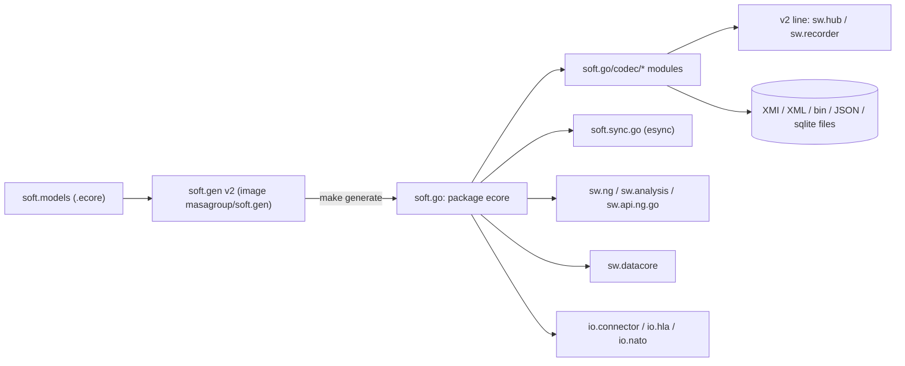
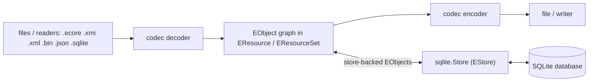

<!--
sword:
  schema: 1
  name: soft.go
  family: ecore-esync
  kind: go-lib
  generation: next-gen
  shipped: false
  languages: [Go, Makefile, YAML]
  build: [go, make]
  ng: [history, hub, recorder, datacore, esync, ecore-model, hla]
  apps: []
-->

# soft.go

[](https://github.com/masagroup/soft.go/blob/master/LICENSE)

[](https://github.com/masagroup/soft.go)


> Go implementation of the Eclipse EMF Ecore metamodel runtime (EObject, EClass, EResource, notifications) with model codecs in separate Go modules (XMI, XML, binary, JSON, SQLite) and a SQLite-backed `EStore`; it is the model foundation library of the Next-Gen Go services and of the esync library `soft.sync.go`.

| | |
|---|---|
| **Family** | Ecore / esync (the [Soft](https://github.com/masagroup/soft) family) |
| **Kind** | Go library (Go workspace of 8 modules: the core, 6 codec modules, the integration tests) |
| **Languages** | Go (100% of sources), Makefile, YAML |
| **Remote / branch** | github.com/masagroup/soft.go, default branch `master` |
| **Generation** | next gen (not shipped): consumed as Go modules by NG services, no binary or artifact of its own |
| **Build systems** | Go (`go.work`) · Makefile (generation with soft.gen v2, run from its Docker image `masagroup/soft.gen:v2.0.0-alpha.4`; `go` runs in a `golang` container when Go is missing). No Ant, no Dockerfile, no docker-compose, no CMake, no npm |

## Overview

soft.go provides the Go runtime of the Ecore metamodel: the generated metamodel classes (`EClass`, `EPackage`, `EAttribute`, ...), several `EObject` flavours (basic, compact, dynamic, reflective, store-backed), collections, EMF-style notifications and adapters, resources and resource sets, URI handlers, ID managers, and the codec abstraction. The codecs that read and write model resources are separate packages and modules under `codec/` (see [Codecs](#codecs)). `codec/sqlite` also ships `sqlite.Store` (named `SQLStore` up to v1.12), an `EStore` implementation where every feature access of a store-backed `EObject` becomes a SQL query on a SQLite database.

The repository is a pure library: no `package main`, no network listener, no `flag` / `os.Getenv` usage in non-test code. It is consumed with `go get github.com/masagroup/soft.go` plus `go get` of the codec modules it uses (Go module proxy / GitHub tags). Module paths: `github.com/masagroup/soft.go` (package `ecore`), `github.com/masagroup/soft.go/codec/{xml,xmi,binary,sqlite,json,defaults}`, and `github.com/masagroup/soft.go/test/integration` (tests only), all `go 1.27.0`, tied together by `go.work`.

Who uses it (from their `go.mod`):

| Consumer | Version required |
|---|---|
| `soft/soft.sync.go` (esync) | v1.12.0 on `master`; v1.13.3 and the `codec/binary`, `codec/xmi`, `codec/xml` v1.0.0 modules on `release/v2` (module `soft.sync.go/v2`) |
| `soft/soft.sync.studio/devserver` | v1.13.3 (codec modules indirect) |
| `soft/soft.gen` (v2 generator) | v1.13.3-0.20261022175029-abd1d4df298b, with `codec/xmi` and `codec/xml` pseudo-versions (loads the `.ecore` models) |
| `sw/sw.ng/src` | v1.11.0 |
| `sw/sw.datacore` | v1.11.0, replaced by fork `github.com/BenSouchet/soft.go v1.10.3-0.20261020150046-020a766d99c1` |
| `sw/sw.analysis/src`, `sw/sw.api.ng.go` | v1.11.0; v1.13.3 and `codec/xml` v1.0.0 on the `release/v2` branch of sw.api.ng.go (module `sw.api.ng.go/v2`) |
| `sw/sw.recorder` | v1.13.3 and `codec/xml` v1.0.0 |
| `sw/sw.hub` | v1.13.3 (indirect, through `soft.sync.go/v2` and `sw.api.ng.go/v2`) |
| `io/io.connector`, `io/io.nato` | v1.11.0 |
| `io/io.hla` | v1.10.2 |
| `soft/soft` (umbrella repo, submodule `go`) | v1.7.0 (stale) |

The sw.* / io.* consumers of the v1 line are on v1.11.0 (io.hla on v1.10.2) while HEAD is v1.13.3 (2026-10-23); the v2 line (sw.hub, sw.recorder, the `release/v2` branches of soft.sync.go and sw.api.ng.go, the soft.sync.studio devserver) is on v1.13.3 with the codec modules. Since v1.13.0 the codecs are no longer in `ecore`: a consumer upgrading from v1.10 / v1.11 / v1.12 must require the codec modules and rename the codec symbols (see [Migration from v1.12](#migration-from-v112)).



## Repository layout

```
soft.go/
  ecore/                    package `ecore` of the root module (~191 non-test .go files, ~150 *_test.go), generated + hand-written
    .soft.gen.yaml          marker written by soft.gen (generator, version, package; `.soft-gen.yaml` up to soft.gen v2.0.0-alpha.2)
  codec/                    one Go module per codec, each with its own go.mod and testdata/
    xml/                    XML codec, `xml.Processor`, extended metadata, XML namespaces
    xmi/                    XMI codec and processor (requires codec/xml)
    binary/                 msgpack binary codec
    sqlite/                 SQLite codec and `sqlite.Store` (EStore)
    json/                   JSON encoder and decoder (standard library only)
    defaults/               imports xmi, xml, binary and sqlite for their registration
  test/                     generated test models (root module) and integration tests
    library/                library model (generated, gitignored) + hand-written writer_ext.go
    tournament/             tournament model: shared package + interfaces + mocks (generated, gitignored except tournamentpackage_impl.go)
      typed/, reflective/   two implementations of the shared tournament package (generated, gitignored)
    empty/                  empty model (generated, gitignored)
    integration/            module `test/integration`: serialization, content-adapter, XML and coexistence tests on the generated models
  .github/workflows/        build_and_test.yaml (single workflow)
  Makefile                  generate / fmt / lint / build / test / coverage
  go.work, go.work.sum      workspace of the 8 modules
  .generator.yaml           generator properties: only fileNotes (MPL header injected by the generator); was generator.properties up to v1.13.1
  .golangci.yaml            golangci-lint v2 config (ignores SA1019 for staticcheck)
  .mockery.yaml             mockery config (inpackage, with-expecter)
  go.mod, go.sum, LICENSE (MPL 2.0), README.md
```

File-naming convention in `ecore/`: `<x>.go` = interface, `<x>_impl.go` = generated implementation, `<x>_ext.go` = hand-written extension, `<x>_mock.go` = mock (generated by soft.gen for the metamodel, by mockery for the hand-written interfaces). Generated files start with `// Code generated by soft.gen go. DO NOT EDIT.` (`soft-gen go` before v1.13.2).

## Build

The only build system is the root `Makefile` plus the standard Go toolchain (GNU make required; the Makefile detects `go` / `go.exe` and Windows vs POSIX `mkdir`, so it runs on both Windows and Linux).

### Windows (Ant)

Not applicable: no `build.xml`.

### Linux (Docker)

Not applicable: no `Dockerfile` or `docker-compose.yaml`. Docker is used by `make generate` (image `masagroup/soft.gen:v2.0.0-alpha.4`, always), by `make lint` (image `golangci/golangci-lint:v2.14.0-alpine`), and to run `go` in a container (image `golang:1.27.3-alpine`) when Go is not installed (see below).

### Other

#### Go and Makefile

Run from the repository root:

```powershell
# core and codecs only (ecore/ and codec/ are committed, no generation needed)
go build ./ecore/...
go test -covermode=atomic ./ecore/...
go -C codec/sqlite test -covermode=atomic ./...   # same for codec/xml, codec/xmi, codec/binary, codec/json

# full pipeline as in CI (needs Docker, Go or the golang container, and the soft.models repo checked out as ../models)
make generate build test

# lint (Docker)
make lint
```

Makefile targets:

| Target | What it does |
|---|---|
| `all` (default) | `generate fmt lint build test` |
| `generate` | Runs `soft.gen go` 6 times on `.ecore` models from `../models` with `-P .generator.yaml`: `ecore.ecore` -> repo root (regenerates `ecore/`); `empty.ecore`, `library.ecore` -> `test/`; `tournament.ecore` 3 times with `-p packageInstance=interfaces -p module=github.com/masagroup/soft.go` and the package paths of `-p packages=...`: interfaces and mocks (`-t generateInterfaces -t generateMocks -t generateMocksTests`) into `test/tournament`, typed implementation (`-t generateImplementations -t generateTests`) into `test/tournament/typed`, reflective implementation (same templates plus `-p featureDelegation=Reflective`) into `test/tournament/reflective` |
| `fmt` | `go -C <module> fmt ./...` for each module of `MODULES` |
| `lint` | `docker run golangci/golangci-lint:v2.14.0-alpine golangci-lint run --timeout=5m` |
| `build` | `go -C <module> build ./...` for each module of `MODULES` |
| `test` | `go -C <module> test -covermode=atomic ./...` for each module of `MODULES` |
| `coverage.console` / `coverage.html` | coverage profile of the root module in `coverage/` (gitignored) |

Makefile variables:

| Variable | Value |
|---|---|
| `MODULES` | `. codec/xml codec/xmi codec/json codec/binary codec/sqlite codec/defaults test/integration` |
| `SOFT_GEN_VERSION` | `v2.0.0-alpha.4` (`v2.0.0-alpha.2` up to v1.13.1, `v2.0.0-alpha.3` in v1.13.2) |
| `SOFT_GEN_IMAGE` | `masagroup/soft.gen:$(SOFT_GEN_VERSION)` (overridable with `?=`) |
| `SOFT_GEN` | `docker run --rm $(SOFT_GEN_USER) -v $(CURDIR):/soft/go -v $(realpath ../models):/soft/models -w /soft/go $(SOFT_GEN_IMAGE)`: the generator runs from its image, the repository mounted on `/soft/go` and the models folder on `/soft/models`; on Linux `SOFT_GEN_USER` (`--user <uid>:<gid>`) gives the generated files to the user. Up to v1.13.1 the Makefile ran `go run github.com/masagroup/soft.gen/v2/cmd/soft-gen@v2.0.0-alpha.2` instead (the command is `cmd/soft-gen` up to soft.gen `v2.0.0-alpha.2`, `cmd/soft.gen` from `v2.0.0-alpha.3`) |
| `GO` | the `go` found (`go`, else `go.exe`); without Go, `docker run --rm` of `GOLANG_IMAGE` with the repository mounted on `/src`, the Go module cache and build cache in the volumes `soft.go-gomod` and `soft.go-gocache`, and `GOFLAGS=-buildvcs=false`: `fmt`, `build`, `test` and the coverage targets then run in the container |
| `GOLANG_IMAGE` | `golang:1.27.3-alpine` (overridable with `?=`; its Go must support the `go` directive of `go.work`) |
| `GENERATE` | `$(call GENERATE,<output folder>,<model>,<options>)` = `$(SOFT_GEN) go -m ../models/<model> -o ./<output folder> -P .generator.yaml <options>` (extra options: `-t <template>`, `-p key=value`) |

Gotchas:

- The `test/` tree mostly contains generated, gitignored code (`test/*/.gitignore` ignores `*.go` and `go.sum`, whitelisting only hand-written files: `test/library/writer_ext.go` and `test/tournament/tournamentpackage_impl.go`; in `test/tournament` the `*/.soft.gen.yaml` of the implementations are ignored too). The generated models belong to the root module, and the integration tests of `test/integration` import them, so `make build` / `make test` (and `go build ./...` in the root module) on a fresh clone only work after `make generate`.
- `make generate` reads the models from `../models` (it mounts `$(realpath ../models)` on `/soft/models` in the soft.gen container). In the ecosystem workspace the models repo lives at `..\soft.models`, not `..\models` (CI checks it out as `models`). Running `make generate` locally therefore needs a `models` folder or link next to the repo (UNVERIFIED how developers handle this).
- The mockery mocks are generated with the config in `.mockery.yaml` (headers say mockery v2.53.2); the mockery version is not pinned in the Makefile.

## Run

Not applicable: the repository has no executable and no service. The only I/O performed by the library is:

- file system via `FileURIHandler` (`ecore/fileurihandler.go`) and an in-memory `MemoryURIHandler` (`ecore/memoryurihandler.go`, `memory:` scheme);
- SQLite database files via `zombiezen.com/go/sqlite` (pure Go, no CGO) in `codec/sqlite`; the SQLite codec creates temporary `.sqlite` files in `os.TempDir()` when decoding from an `io.Reader`, encoding to an `io.Writer`, and in `sqlite.Store.Serialize` (`sqlTmpDB`, `codec/sqlite/sqlcodec.go`).

It opens no port and reads no environment variable.

Minimal usage:

```go
import (
  "github.com/masagroup/soft.go/ecore"
  _ "github.com/masagroup/soft.go/codec/defaults" // XMI, XML, binary and SQLite codecs, registered by extension
)
```

## Codecs

The `ecore` module only holds the codec abstraction (`ECodec`, `ECodecRegistry`) and maps the `memory` protocol to `NoCodec`. The codecs are separate packages and modules, so a program only depends on the libraries of the codecs it uses:

| Package | Module | Codec | Extensions registered on import |
|---|---|---|---|
| `github.com/masagroup/soft.go/codec/xmi` | same as the package (requires `codec/xml`) | XMI | `ecore`, `xmi` |
| `github.com/masagroup/soft.go/codec/xml` | same as the package | XML | `xml` |
| `github.com/masagroup/soft.go/codec/binary` | same as the package | binary (msgpack) | `bin` |
| `github.com/masagroup/soft.go/codec/sqlite` | same as the package | SQLite codec and `Store` | `sqlite` |
| `github.com/masagroup/soft.go/codec/json` | same as the package | JSON (encoder and decoder, standard library only) | `json` |
| `github.com/masagroup/soft.go/codec/defaults` | same as the package | XMI, XML, binary and SQLite | `ecore`, `xmi`, `xml`, `bin`, `sqlite` |

A codec package registers its codecs in the default codec registry when it is imported. To load and save resources by extension as before, import the defaults for their side effects:

```go
import (
  _ "github.com/masagroup/soft.go/codec/defaults"
)
```

Without a codec for the extension of a resource, `Load` and `Save` fail with an error naming the package to import. Codecs can also be registered with `ecore.RegisterCodec(extension, codec)`, or per resource set in `resourceSet.GetCodecRegistry()`.

The packages are named like `encoding/xml`, `encoding/binary`, `zombiezen.com/go/sqlite` and `encoding/json`: a file importing both names one of them, for instance `xmlcodec "github.com/masagroup/soft.go/codec/xml"`.

### Migration from v1.12

The package name replaces the prefix of the names:

| v1.12 (`ecore`) | now |
|---|---|
| `XMICodec`, `NewXMIProcessor`, `NewXMIEncoder`, `NewXMIDecoder` | `xmi.Codec`, `xmi.NewProcessor`, `xmi.NewEncoder`, `xmi.NewDecoder` |
| `XMLCodec`, `NewXMLProcessor`, `XMLProcessorPackages`, `XMLProcessorResourceSet`, `XML_OPTION_*` | `xml.Codec`, `xml.NewProcessor`, `xml.ProcessorPackages`, `xml.ProcessorResourceSet`, `xml.OPTION_*` |
| `XMIProcessorPackages`, `XMIProcessorResourceSet` | `xml.ProcessorPackages`, `xml.ProcessorResourceSet` |
| `BinaryCodec`, `NewBinaryEncoder`, `NewBinaryDecoder`, `BINARY_OPTION_*` | `binary.Codec`, `binary.NewEncoder`, `binary.NewDecoder`, `binary.OPTION_*` |
| `SQLCodec`, `SQLStore`, `NewSQLStore`, `SQLObject`, `SQL_OPTION_*`, `ErrSQLStoreFailed` | `sqlite.Codec`, `sqlite.Store`, `sqlite.NewStore`, `sqlite.Object`, `sqlite.OPTION_*`, `sqlite.ErrStoreFailed` |
| `JSONCodec`, `NewJSONEncoder`, `JSON_OPTION_ID_ATTRIBUTE_NAME` | `json.Codec`, `json.NewEncoder`, `json.OPTION_ID_ATTRIBUTE_NAME` |

## Several implementations of a metamodel

A program may link several complete generated implementations of the same metamodel (for instance one with typed fields and one with reflective delegation). They share the nsURI and the classifier and feature IDs, but each has its own `EPackage` instance and its own `EFactory`.

A package registry holds one package per nsURI, so the implementation is chosen per resource set: register the package of the implementation a resource set uses in that resource set's registry, with `ecore.CreateEResourceSet(packages)`, `xml.ProcessorPackages(packages)` or `resourceSet.GetPackageRegistry().RegisterPackage(pack)`. The global registry (`ecore.GetPackageRegistry()`) holds `ecore` only and stays neutral: generated packages never register themselves in it.

```go
fieldsSet := ecore.CreateEResourceSet([]ecore.EPackage{fields.GetPackage()})
storeSet := ecore.CreateEResourceSet([]ecore.EPackage{store.GetPackage()})
```

What works within one implementation and across two implementations of the same metamodel:

| Operation | Same implementation | Across (same nsURI, same IDs) |
| --- | --- | --- |
| generated factory `Create` / `CreateFromString` / `ConvertToString` | works | works, by classifier ID; the result belongs to the factory's package |
| dynamic `EFactoryExt` | works | panics (package mismatch), unchanged |
| `EGetFromID` / `ESetFromID`, `GetEStructuralFeature(id)`, `...FromName` | works | works |
| `EGet` / `ESet` / `EIsSet` / `EUnset(feature)` | works | panics "not a valid feature": look the feature up by ID or name on `obj.EClass()` first |
| load into a resource set with one implementation registered | works | works; the whole resource is that implementation |
| save a resource mixing implementations | n/a | unsupported |
| `Copy` | works, same implementation | not a cross copy |
| `Equals`, `IsSuperTypeOf`, `IsInstance`, proxies across resource sets | works | false / unsupported |

### One shared package, several implementations

Generated with the property `packageInstance=interfaces` of soft.gen go (soft.gen v2), the package of a metamodel (`GetPackage`) is generated once, with its interfaces, and shared by its implementations: each implementation (`generateImplementations`, one run each) holds its classes and a factory of its own (`GetFactory`), whose package is the shared one. The objects of all implementations have the same `EClass`. The factory instance of the shared package only converts data types: its `Create` panics. The tournament test model (`test/tournament`, `typed/`, `reflective/`) is generated this way.

The implementation a resource set creates its objects with (load, XML, binary and SQL) is the factory registered for the nsURI in its package registry:

```go
typedSet := ecore.CreateEResourceSet([]ecore.EPackage{model.GetPackage()})
typedSet.GetPackageRegistry().RegisterFactory(typed.GetFactory())
reflectiveSet := ecore.CreateEResourceSet([]ecore.EPackage{model.GetPackage()})
reflectiveSet.GetPackageRegistry().RegisterFactory(reflective.GetFactory())
```

There is no global default implementation: each resource set chooses its implementation in its registry. The generated `Install(registry)` of an implementation registers the shared package and the factory of the implementation (`typed.Install(resourceSet.GetPackageRegistry())`).

`ecore.GetObjectFactory(obj)` returns the factory of the implementation of an object: `Copy` and the entries of maps are of the implementation of the object they come from. The objects of different implementations of a shared package do not mix: containing, referencing (lists, single references, `ESet`) or adding as a root of the same resource an object of another implementation panics (`ecore.CheckSameImplementation`) when the program is built with the tag `ecore_check` (`ecore.Checks`). Without it, the checks are compiled out and cost nothing. The same tag enables the other checks of programming errors, such as setting an element of a unique list to an element it holds at another index. The property `checkImplementation=false` of soft.gen go (soft.gen v2) also leaves them out of the generated setters. Within one implementation, everything works as with a complete package, including `EGet` / `ESet` with the features of `GetPackage()`, `Equals` and `IsSuperTypeOf`.

## Dependencies

### Internal

Upstream (what soft.go depends on):

| Repository | How it is pulled | What for |
|---|---|---|
| [soft.gen](https://github.com/masagroup/soft.gen) v2 | Docker image `masagroup/soft.gen:v2.0.0-alpha.4` run by the `Makefile` (`SOFT_GEN_VERSION`, `SOFT_GEN` / `GENERATE` macros, properties in `.generator.yaml`), not a `go.mod` require; `go run github.com/masagroup/soft.gen/v2/cmd/soft-gen@v2.0.0-alpha.2` up to v1.13.1 | Generates `ecore/*.go` and the `test/` models |
| [soft.models](https://github.com/masagroup/soft.models) | CI checkout of `masagroup/soft.models` pinned at `90286c344159492747920472760ac3904b19e784`; Makefile expects `../models` | Source `.ecore` metamodels: `ecore.ecore`, `empty.ecore`, `library.ecore`, `tournament.ecore` |

The only `github.com/masagroup/*` requires are between the modules of this repository: the codec modules require `github.com/masagroup/soft.go v1.13.0` and the codec modules they build on (`codec/xml v1.0.0`, `codec/xmi v1.0.0`, ...), resolved locally by `go.work`. No `.gitmodules`, no Ant `<update>`.

Downstream (who requires soft.go):

| Repository | How it is pulled | What for |
|---|---|---|
| [soft.sync.go](https://github.com/masagroup/soft.sync.go) | go.mod (v1.12.0 on `master`; v1.13.3 and the codec modules `binary`, `xmi`, `xml` on `release/v2`) | esync; on `master` uses `ecore.NewSQLStore` in `internal/ehistory/history/history_builder_database.go`, `history_database_reader_database.go`, `history_sync_reader_database.go` (`sqlite.NewStore` of `codec/sqlite` since v1.13.0); `release/v2` does not require `codec/sqlite` |
| [soft.sync.studio](https://github.com/masagroup/soft.sync.studio) (devserver) | go.mod (v1.13.3) | Dev server of the v2 web UI |
| [soft.gen](https://github.com/masagroup/soft.gen) | go.mod (v1.13.3-0.20261022175029-abd1d4df298b, `codec/xmi` and `codec/xml` pseudo-versions) | Loads the `.ecore` models it generates from |
| [sw.ng](https://github.com/masagroup/sw.ng) | go.mod (v1.11.0) | Ecore model runtime |
| [sw.datacore](https://github.com/masagroup/sw.datacore) | go.mod (v1.11.0) + `replace` to fork `github.com/BenSouchet/soft.go` | Ecore model runtime (fork reason UNVERIFIED) |
| [sw.analysis](https://github.com/masagroup/sw.analysis), [sw.api.ng.go](https://github.com/masagroup/sw.api.ng.go) | go.mod (v1.11.0; v1.13.3 and `codec/xml` on the `release/v2` branch of sw.api.ng.go) | Ecore model runtime |
| [sw.recorder](https://github.com/masagroup/sw.recorder) | go.mod (v1.13.3 and `codec/xml` v1.0.0) | Ecore model runtime and XML codec |
| [sw.hub](https://github.com/masagroup/sw.hub) | go.mod (v1.13.3, indirect) | Through `soft.sync.go/v2` and `sw.api.ng.go/v2` |
| [io.connector](https://github.com/masagroup/io.connector), [io.nato](https://github.com/masagroup/io.nato) | go.mod (v1.11.0) | Ecore model runtime |
| [io.hla](https://github.com/masagroup/io.hla) | go.mod (v1.10.2) | Ecore model runtime |
| [soft](https://github.com/masagroup/soft) (umbrella repo) | git submodule `go`, pinned at v1.7.0 (`go 1.20`, commit c80fbf86) | Stale second copy of the module on disk (`soft\soft\go`) |

The codec modules are required by the v2 line only: `soft.sync.go/v2`, `sw.api.ng.go/v2`, sw.recorder (direct), sw.hub and the soft.sync.studio devserver (indirect), plus soft.gen. The other consumers are on versions where the codecs were in `ecore`.

Indirect esync path: `sw.ng/src`, `sw.analysis/src`, `sw.api.ng.go` and `io.connector` require `soft.sync.go` v1.6.2 and `sw.datacore` v1.6.1 (`io.nato` v1.6.2 and `io.hla` v1.6.1: indirect); `sw.datacore` also replaces `soft.sync.go` with the fork `github.com/BenSouchet/soft.sync.go v1.6.2-0.20261017105210-534e68b53610`. sw.hub, sw.recorder and the soft.sync.studio devserver require `soft.sync.go/v2`. Only the `master` of `soft.sync.go` calls `ecore.NewSQLStore` / `SQL_OPTION_*`; no direct SQLStore usage was found in the sw.* / io.* consumers. No `go.mod` under `sw.storage`, `sw.golibs`, `sw.node`, `sw.dos`, `sw.commander`, `sw.mapserver`, `sw.authentication` requires soft.go.

### External

Direct requires, per module:

| Module | Requires | Purpose |
|---|---|---|
| root (`ecore`) | `github.com/google/uuid` v1.6.0, `github.com/oklog/ulid/v2` v2.1.2 | UUID / ULID object IDs |
| root (`ecore`) | `github.com/ugurcsen/gods-generic` v0.10.4 | Generic collections |
| root (`ecore`) | `github.com/stretchr/testify` v1.12.1 | Tests and the in-package mocks |
| `codec/xml` | `golang.org/x/net` v0.61.0 | XML charset handling / escaping |
| `codec/binary` | `github.com/vmihailenco/msgpack/v5` v5.4.1 (+ uuid, ulid) | Binary (`.bin`) codec |
| `codec/sqlite` | `zombiezen.com/go/sqlite` v1.4.2 (indirect `modernc.org/sqlite v1.60.1`) | Pure-Go SQLite driver, connection pools (`sqlitex.Pool`), backup API |
| `codec/sqlite` | `github.com/rqlite/sql` v0.0.0-20261016220845-5c0832fea6e1 | SQL parser: classifies queries read/write and extracts table names (`sqlbase.go`) |
| `codec/sqlite` | `github.com/chebyrash/promise` v0.0.0-20260915144232-ce593674804a | Promise-based async SQL operations |
| `codec/sqlite` | `github.com/panjf2000/ants/v2` v2.12.1 | Goroutine pools (`sqlstore.go`) |
| `codec/sqlite` | `github.com/petermattis/goid` v0.0.0-20260918085751-abfca077860b | Goroutine ID tracking for re-entrant SQL operations |
| `codec/sqlite` | `go.uber.org/zap` v1.28.0 | Logging (`OPTION_LOGGER`), default `zap.NewNop()` |
| `codec/sqlite` | `github.com/davecgh/go-spew` v1.1.1, `github.com/pmezard/go-difflib` v1.0.0 | Diff output when comparing SQLite databases (`sqlequal.go`) |
| `codec/json` | none outside the repository (standard library; testify for tests) | JSON encoder and decoder |

The `*_mock.go` files of `ecore` are compiled into the library package, so testify is linked into every consumer, not only tests; likewise `codec/sqlite` compiles `sqlobject_mock.go` and `sqlequal.go` (exported `RequireEqualDB`), so its consumers also link go-spew and go-difflib.

Tooling: Go 1.27.x (`go.mod`, CI matrix), `masagroup/soft.gen:v2.0.0-alpha.4` (generation), `golang:1.27.3-alpine` (`go` without Go installed), `golangci/golangci-lint:v2.14.0-alpine`, mockery, `actions/setup-go@v5`, `actions/checkout@v4`.

## Architecture

The core lives in the package `ecore` (root module); each codec is a package of its own module under `codec/`.

1. **Ecore metamodel** (generated from `ecore.ecore`): `EModelElement`, `ENamedElement`, `EClassifier`, `EClass`, `EDataType`, `EEnum`, `EEnumLiteral`, `EStructuralFeature`, `EAttribute`, `EReference`, `EOperation`, `EParameter`, `EPackage`, `EFactory`, `EAnnotation`, `EGenericType`, `ETypeParameter`, `EStringToStringMapEntry`; `ecorepackage(_impl).go` (`NS_URI = "http://www.eclipse.org/emf/2002/Ecore"`), `ecorefactory(_impl).go`. The generator annotation source `http://net.masagroup/soft/2019/GenGo` is read in `edatatype_ext.go`.
2. **EObject flavours**: `abstracteobject.go`, `basiceobject_impl.go`, `compacteobject_impl.go` (bit-flag compact storage), `dynamiceobject_impl.go`, `reflectiveeobject_impl.go`, and store-backed variants `estoreeobject_impl.go`, `compactestoreeobject_impl.go`, `reflectiveestoreeobject_impl.go`. `EStoreEObject` = `EObject + EStoreProvider + ECacheProvider + ELockProvider`. The generator option `featureDelegation=Reflective` targets the reflective variants.
3. **Collections**: `EList`, `EObjectList`, `ENotifyingList`, `EMap`, basic / immutable / delegating / store-backed lists and maps (`basicelist.go`, `basicenotifyinglist.go`, `estorelist.go`, `estoremap.go`), iterators and `eallcontents.go`.
4. **Notifications and adapters**: `ENotifier`, `ENotification`, `ENotificationChain`, `EAdapter`, `EContentAdapter` (EMF observer pattern, the basis on which esync observes model changes).
5. **Resources**: `EResource` (Load/Save with options, `GetEObject(fragment)`, errors/warnings, `EObjectIDManager`), `EResourceSet`, `EPackageRegistry` (packages and, for shared packages, factories: `RegisterFactory`), `EURIConverter` + `EURIHandler` (file, memory), `URI` / `URIBuilder`.
6. **ID managers**: `EObjectIDManager`; generic `UniqueIDManager[ID]` with `UUIDManager`, `ULIDManager`, `IncrementalIDManager`.
7. **Codecs** (`ECodec` -> `EEncoder` / `EDecoder`), selected by `ECodecRegistry` by URI scheme, then extension, then `*` default, then delegate. `ecore` only maps the `memory:` scheme to `NoCodec`; the codec packages register their extensions when imported (see [Codecs](#codecs)). Options:

| Codec | Options |
|---|---|
| `xmi.Codec` | no option constant of its own; XMI processor built on `codec/xml` (`xml.ProcessorPackages`, `xml.ProcessorResourceSet`) |
| `xml.Codec` | `OPTION_EXTENDED_META_DATA`, `OPTION_SUPPRESS_DOCUMENT_ROOT`, `OPTION_DEFERRED_REFERENCE_RESOLUTION`, `OPTION_DEFERRED_ROOT_ATTACHMENT`, `OPTION_ID_ATTRIBUTE_NAME`, `OPTION_ROOT_OBJECTS` |
| `binary.Codec` | msgpack; `OPTION_ID_ATTRIBUTE`, `OPTION_NAMESPACE_ATTRIBUTE` (value `"NAMESPACE_ATTIBUTE"`, sic) |
| `sqlite.Codec` | options in `codec/sqlite/sqlcodec.go` (`OPTION_KEEP_DEFAULTS`, `OPTION_CODEC_VERSION`, `OPTION_OBJECT_ID`, `OPTION_CONTAINER_ID`, `OPTION_SQL_ID_MANAGER`, `OPTION_IN_MEMORY_DATABASE`, `OPTION_DECODER_WITH_FEATURES`, `OPTION_DECODER_WITH_OBJECTS`, `OPTION_DECODER_DB_PATH`, `OPTION_LOGGER`, `OPTION_OPERATION_TIMEOUT`, `OPTION_MAX_ALLOC_SIZE`, `OPTION_COMMIT_MAX_OPERATIONS`, `OPTION_COMMIT_MAX_DURATION`); codec version written to `PRAGMA user_version` |
| `json.Codec` | `OPTION_ID_ATTRIBUTE_NAME`; encoder and decoder |
| `ecore.NoCodec` | `memory:` scheme |

8. **SQLite persistence** (`codec/sqlite`):
   - Schema (`sqlschema.go`): technical tables `.properties`, `.packages`, `.classes`, `.objects` (optional `containerID` / `containerFeatureID` and an optional custom object-ID TEXT column, e.g. `esyncID` in `sqlencoder_test.go`), `.contents`, `.enums`, plus one table per EClass and per many-valued feature (qualified by the package, `package.class` / `package.class.feature`, in new databases; databases written before keep the unqualified names).
   - `Encoder` / `Decoder` (`NewWriterEncoder`, `NewDBEncoder`, `NewReaderDecoder`, `NewDBDecoder`): whole-resource save / load.
   - `Store` (`sqlstore.go`, ~2500 lines) implements `EStore`: every feature get/set/add/remove/move of a store-backed EObject becomes a SQL query on a WAL-mode SQLite pool, or on an in-memory copy backed up to the file on close (`OPTION_IN_MEMORY_DATABASE`). Operations are scheduled asynchronously (ants pool + promises) and ordered per object/feature. Public API includes `NewStore`, `WaitOperations`, `Flush`, `Err`, `GetRoots`, `UnRegister`, `Serialize`, `ExecuteQuery`, `Close`. `sqlbase.go` parses each query with `rqlite/sql` to classify read vs write and the tables touched, enabling concurrent reads.
   - `sqlequal.go`: compares two SQLite model databases (test helper with diff output).
9. **Utilities**: `ecoreutils.go`, `deepcopy.go`, `deepequal.go`, `ediagnostic*.go` in `ecore`; `extendedmetadata.go`, `xmlnamespaces.go` in `codec/xml`. The `ecore_check` build tag (`checks_enabled.go` / `checks_disabled.go`) turns on the programming-error checks (see [One shared package, several implementations](#one-shared-package-several-implementations)).



Data flow: in, files or readers go through a codec decoder into an EObject graph held by an `EResource` / `EResourceSet`; out, the graph goes through an encoder to a file or writer. With `sqlite.Store`, EObjects are thin proxies and the SQLite database is the source of truth (live persistence, used by the esync history in `soft.sync.go`).

Notable patterns: model-driven code generation (soft.gen + soft.models), EMF adapter/notification observer, pluggable codec registry with codecs as opt-in modules, pluggable `EStore`, one shared package with several implementations, mockery in-package mocks, Go iterators (`iter.Seq` in `estore.go`), generics.

## CI/CD

Single workflow: `.github/workflows/build_and_test.yaml` ("Build and Test").

| Item | Value |
|---|---|
| Triggers | pull request to `master` (opened, synchronize, reopened, ready_for_review), push to `master`, `workflow_dispatch` |
| Matrix | `go-version: [1.27.x]`, `os: [ubuntu-latest]` |
| Steps | `actions/setup-go@v5`; checkout this repo into `go/`; checkout `masagroup/soft.models` at pinned SHA `90286c344159492747920472760ac3904b19e784` into `models/`; run `make generate build test` in `go/` (soft.gen runs from the image `masagroup/soft.gen:v2.0.0-alpha.4` with the Docker of the runner, build and test with the installed Go; build and test cover every module of `MODULES`) |
| Shared workflows | None: it does not use the `masagroup/cicd` reusable workflows (contrary to the ecosystem convention); it is a self-contained job. See [cicd](https://github.com/masagroup/cicd) and the ecosystem wiki page "CI/CD pipelines" |
| Lint / coverage | No lint step in CI (`make lint` is not invoked), no coverage upload |
| Artifacts | None: no zip, deb, Docker image or release asset. Releases are plain git tags consumed through the Go module proxy: `v1.13.3`, `v1.13.2`, `v1.13.1`, `v1.13.0`, `v1.12.0`, `v1.11.1`, ... for the root module, `codec/<name>/vX.Y.Z` for the codec modules (`codec/xml/v1.0.0`, `codec/xmi/v1.0.0`, `codec/binary/v1.0.0`, `codec/sqlite/v1.0.0`, `codec/defaults/v1.0.0`, `codec/json/v1.1.0`) |

## Next-gen relevance

| Concept | Status |
|---|---|
| ecore model | Implements the Go Ecore runtime itself (`ecore/` package); see the ecosystem wiki page "esync and ecore" |
| esync | Used by esync: `soft.sync.go` requires soft.go v1.12.0 on `master` and v1.13.3 on `release/v2`. soft.go contains no esync code itself, only a test using an `esyncID` object-ID column |
| history | Indirect: the SQLite store (`SQLStore` up to v1.12, `sqlite.Store` of `codec/sqlite` now) is the persistence engine of esync's history database on the `master` of soft.sync.go (`soft.sync.go/internal/ehistory/history/*_database.go`) |
| hub, recorder | Used by the v2 line: [sw.recorder](https://github.com/masagroup/sw.recorder) requires soft.go v1.13.3 and `codec/xml`, [sw.hub](https://github.com/masagroup/sw.hub) requires it indirectly (both not shipped) |
| storage | Provides SQLite model persistence; `sw.storage` does not depend on soft.go |
| datacore | Used by [sw.datacore](https://github.com/masagroup/sw.datacore) through a fork `replace` to `BenSouchet/soft.go` |
| HLA | Not implemented here; [io.hla](https://github.com/masagroup/io.hla) depends on soft.go |
| gateway, dos, authentication, node, orchestrator, commander, timeline, mapserver, webclient, dispatcher | Unrelated (no code, config or reference in this repo). Of these, only [sw.ng](https://github.com/masagroup/sw.ng) depends on it (v1.11.0) |

See also the ecosystem wiki page "Next-gen ecosystem".

## Known issues

No formal audit exists; the scan report lists the following:

- The previous `Readme.md` stated "We support Go v1.12": outdated, every `go.mod` requires `go 1.27.0` and CI uses 1.27.x. It also omitted the generation workflow (`make generate`, `../models`, soft.gen) and the fact that `test/` requires generation.
- Breaking change for consumers: since v1.13.0 the codecs and the SQLite store are separate modules with renamed symbols (see [Migration from v1.12](#migration-from-v112)); the sw.* / io.* consumers of the v1 line listed above are still on v1.10.2 / v1.11.0 and the `master` of soft.sync.go on v1.12.0; only the v2 line (sw.hub, sw.recorder, the `release/v2` branches, the soft.sync.studio devserver) and soft.gen use v1.13.
- The generator is a pre-release: soft.gen `v2.0.0-alpha.4`, run from the image `masagroup/soft.gen`.
- MPL header is not present in every tracked `.go` file (290 of 375 at v1.11.1; not recounted since the codec split).
- `sqlEscapeIdentifier` (`codec/sqlite/sqlschema.go`) is not a real escaper: it only wraps the name in double quotes if it contains `.` or is an SQLite keyword, and does not escape embedded `"`. A hostile `.ecore` / metamodel with crafted names is an injection vector. Values are bound as `?` parameters.
- `Store.ExecuteQuery` (`codec/sqlite/sqlstore.go`) accepts raw SQL and classifies it read vs write by an exact upper-case `SELECT` first token; anything else (lowercase `select`, `WITH`) is scheduled as a write.
- Temp DB files go to `os.TempDir()` with random names (`sqlTmpDB`, `codec/sqlite/sqlcodec.go`); permissions and cleanup were not checked.
- Supply-chain point to track: the `BenSouchet/soft.go` fork used by sw.datacore.
- Consumers that feed network input into the XML/XMI/msgpack/JSON/SQLite parsers or `ExecuteQuery` should be reviewed before running in containers.

## Open questions

- UNVERIFIED: how developers run `make generate` locally, given the Makefile expects `../models` while the workspace has `../soft.models`.
- UNVERIFIED: why `sw.datacore` replaces soft.go with the `BenSouchet/soft.go` fork, and whether that fork's change (pseudo-version `v1.10.3-0.20261020150046-020a766d99c1`, 2026-10-20; `...20261005102653-6e14d517bed8` before) is merged into v1.11.x or later.
- UNVERIFIED: content and status of the former remote branch `masa/sqlstore.optimization` (masagroup/soft.go only has `master` and `wiki` on 2026-10-23).
- UNVERIFIED: breaking changes between v1.10.2 (io.hla), v1.11.0 (the other sw.* / io.* consumers) and v1.12.0 (`master` of soft.sync.go) (commits of v1.11 mention an adapted promise API), beyond the codec split of v1.13.0.
- UNVERIFIED: whether the `soft` umbrella repo is still maintained, since its `go` submodule is at v1.7.0.
- UNVERIFIED: whether `sw.ng` / other NG services will use the SQLite store directly (no current usage outside `soft.sync.go`).
- UNVERIFIED: impact of CI pinning `soft.models` at `90286c34...` while the local `soft.models` HEAD is `f0dd72e4...`.

## Legacy notes

The previous README of the repository (`Readme.md` of `masa/master at 0a2cf1c`), kept in full; its headings are two levels lower.

[](https://github.com/masagroup/soft.go/blob/master/LICENSE)

[](https://github.com/masagroup/soft.go)

### Soft Go #

Soft Go is an implementation of the EMF Ecore library in Golang. This library is partially generated and referenced by the [Soft Go Generator](https://github.com/masagroup/soft.gen)
 
Soft Go is part of [Soft](https://github.com/masagroup/soft) project

### Installation #
To install Ecore, use go get:
```shell
go get github.com/masagroup/soft.go
```

This will then make the following packages available to you:
```
github.com/masagroup/soft.go/ecore
```

Import the masagroup/soft.go/ecore package into your code using this template:
```Golang
package yours

import (
  "github.com/masagroup/soft.go/ecore"
)
```

### Codecs #
The `ecore` module only holds the codec abstraction (`ECodec`, `ECodecRegistry`) and maps the `memory` protocol to `NoCodec`. The codecs are separate packages and modules, so a program only depends on the libraries of the codecs it uses:

| Package | Module | Codec | Extensions registered on import |
|---|---|---|---|
| `github.com/masagroup/soft.go/codec/xmi` | same as the package (requires `codec/xml`) | XMI | `ecore`, `xmi` |
| `github.com/masagroup/soft.go/codec/xml` | same as the package | XML | `xml` |
| `github.com/masagroup/soft.go/codec/binary` | same as the package | binary (msgpack) | `bin` |
| `github.com/masagroup/soft.go/codec/sqlite` | same as the package | SQLite codec and `Store` | `sqlite` |
| `github.com/masagroup/soft.go/codec/json` | same as the package | JSON (encoder and decoder, standard library only) | `json` |
| `github.com/masagroup/soft.go/codec/defaults` | same as the package | XMI, XML, binary and SQLite | `ecore`, `xmi`, `xml`, `bin`, `sqlite` |

A codec package registers its codecs in the default codec registry when it is imported. To load and save resources by extension as before, import the defaults for their side effects:
```Golang
import (
  _ "github.com/masagroup/soft.go/codec/defaults"
)
```

Without a codec for the extension of a resource, `Load` and `Save` fail with an error naming the package to import. Codecs can also be registered with `ecore.RegisterCodec(extension, codec)`, or per resource set in `resourceSet.GetCodecRegistry()`.

The packages are named like `encoding/xml`, `encoding/binary`, `zombiezen.com/go/sqlite` and `encoding/json`: a file importing both names one of them, for instance `xmlcodec "github.com/masagroup/soft.go/codec/xml"`.

#### Migration from v1.12 ##
The package name replaces the prefix of the names:

| v1.12 (`ecore`) | now |
|---|---|
| `XMICodec`, `NewXMIProcessor`, `NewXMIEncoder`, `NewXMIDecoder` | `xmi.Codec`, `xmi.NewProcessor`, `xmi.NewEncoder`, `xmi.NewDecoder` |
| `XMLCodec`, `NewXMLProcessor`, `XMLProcessorPackages`, `XMLProcessorResourceSet`, `XML_OPTION_*` | `xml.Codec`, `xml.NewProcessor`, `xml.ProcessorPackages`, `xml.ProcessorResourceSet`, `xml.OPTION_*` |
| `XMIProcessorPackages`, `XMIProcessorResourceSet` | `xml.ProcessorPackages`, `xml.ProcessorResourceSet` |
| `BinaryCodec`, `NewBinaryEncoder`, `NewBinaryDecoder`, `BINARY_OPTION_*` | `binary.Codec`, `binary.NewEncoder`, `binary.NewDecoder`, `binary.OPTION_*` |
| `SQLCodec`, `SQLStore`, `NewSQLStore`, `SQLObject`, `SQL_OPTION_*`, `ErrSQLStoreFailed` | `sqlite.Codec`, `sqlite.Store`, `sqlite.NewStore`, `sqlite.Object`, `sqlite.OPTION_*`, `sqlite.ErrStoreFailed` |
| `JSONCodec`, `NewJSONEncoder`, `JSON_OPTION_ID_ATTRIBUTE_NAME` | `json.Codec`, `json.NewEncoder`, `json.OPTION_ID_ATTRIBUTE_NAME` |

### Several implementations of a metamodel #
A program may link several complete generated implementations of the same metamodel (for instance one with typed fields and one with reflective delegation). They share the nsURI and the classifier and feature IDs, but each has its own `EPackage` instance and its own `EFactory`.

A package registry holds one package per nsURI, so the implementation is chosen per resource set: register the package of the implementation a resource set uses in that resource set's registry, with `ecore.CreateEResourceSet(packages)`, `xml.ProcessorPackages(packages)` or `resourceSet.GetPackageRegistry().RegisterPackage(pack)`. The global registry (`ecore.GetPackageRegistry()`) holds `ecore` only and stays neutral: generated packages never register themselves in it.

```Golang
fieldsSet := ecore.CreateEResourceSet([]ecore.EPackage{fields.GetPackage()})
storeSet := ecore.CreateEResourceSet([]ecore.EPackage{store.GetPackage()})
```

What works within one implementation and across two implementations of the same metamodel:

| Operation | Same implementation | Across (same nsURI, same IDs) |
| --- | --- | --- |
| generated factory `Create` / `CreateFromString` / `ConvertToString` | works | works, by classifier ID; the result belongs to the factory's package |
| dynamic `EFactoryExt` | works | panics (package mismatch), unchanged |
| `EGetFromID` / `ESetFromID`, `GetEStructuralFeature(id)`, `...FromName` | works | works |
| `EGet` / `ESet` / `EIsSet` / `EUnset(feature)` | works | panics "not a valid feature": look the feature up by ID or name on `obj.EClass()` first |
| load into a resource set with one implementation registered | works | works; the whole resource is that implementation |
| save a resource mixing implementations | n/a | unsupported |
| `Copy` | works, same implementation | not a cross copy |
| `Equals`, `IsSuperTypeOf`, `IsInstance`, proxies across resource sets | works | false / unsupported |

#### One shared package, several implementations ##
Generated with the property `packageInstance=interfaces` of soft.gen go (soft.gen v2), the package of a metamodel (`GetPackage`) is generated once, with its interfaces, and shared by its implementations: each implementation (`generateImplementations`, one run each) holds its classes and a factory of its own (`GetFactory`), whose package is the shared one. The objects of all implementations have the same `EClass`. The factory instance of the shared package only converts data types: its `Create` panics.

The implementation a resource set creates its objects with (load, XML, binary and SQL) is the factory registered for the nsURI in its package registry:

```Golang
typedSet := ecore.CreateEResourceSet([]ecore.EPackage{model.GetPackage()})
typedSet.GetPackageRegistry().RegisterFactory(typed.GetFactory())
reflectiveSet := ecore.CreateEResourceSet([]ecore.EPackage{model.GetPackage()})
reflectiveSet.GetPackageRegistry().RegisterFactory(reflective.GetFactory())
```

There is no global default implementation: each resource set chooses its implementation in its registry. The generated `Install(registry)` of an implementation registers the shared package and the factory of the implementation (`typed.Install(resourceSet.GetPackageRegistry())`).

`ecore.GetObjectFactory(obj)` returns the factory of the implementation of an object: `Copy` and the entries of maps are of the implementation of the object they come from. The objects of different implementations of a shared package do not mix: containing, referencing (lists, single references, `ESet`) or adding as a root of the same resource an object of another implementation panics (`ecore.CheckSameImplementation`) when the program is built with the tag `ecore_check` (`ecore.Checks`). Without it, the checks are compiled out and cost nothing. The same tag enables the other checks of programming errors, such as setting an element of a unique list to an element it holds at another index. The property `checkImplementation=false` of soft.gen go (soft.gen v2) also leaves them out of the generated setters. Within one implementation, everything works as with a complete package, including `EGet` / `ESet` with the features of `GetPackage()`, `Equals` and `IsSuperTypeOf`.

### Supported go versions #
We support Go v1.12
